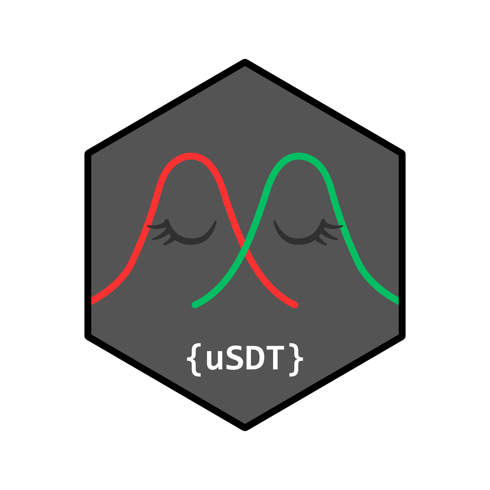

# uSDT 

<!-- badges: start -->
[](https://CRAN.R-project.org/package=uSDT)
[](https://CRAN.R-project.org/package=uSDT)
[](https://github.com/RicardoReySaez/uSDT/actions/workflows/R-CMD-check.yaml)
[](https://github.com/RicardoReySaez/uSDT/actions/workflows/pkgdown.yaml)
[](https://app.codecov.io/gh/RicardoReySaez/uSDT)
<!-- badges: end -->

`uSDT` fits hierarchical signal detection theory models to paired awareness
and influence measures. It compares mean sensitivities, estimates their latent
association and tests influence sensitivity at zero awareness sensitivity.
It supports maximum likelihood and Bayesian estimation, Bayes factors and
study planning for power, precision, cost and detectable effects.

## Documentation

Visit the [documentation](https://ricardoreysaez.github.io/uSDT/) for the
package:

- [Getting started](https://ricardoreysaez.github.io/uSDT/articles/uSDT-tutorial.html),
  from trial-level data to the three hypotheses.
- [Bayesian estimation](https://ricardoreysaez.github.io/uSDT/articles/uSDT-bayesian.html),
  priors, posterior summaries and Bayes factors.
- [Planning a study](https://ricardoreysaez.github.io/uSDT/articles/uSDT-power.html),
  power analysis and the choice of subjects and trials.
- [Reference](https://ricardoreysaez.github.io/uSDT/reference/index.html), the
  help page of every function.
- [Changelog](https://ricardoreysaez.github.io/uSDT/news/index.html), the
  changes in each release.

The [CRAN release](https://CRAN.R-project.org/package=uSDT) may have an older API.

## Installation

Install the released version from CRAN:

```r
install.packages("uSDT")
```

Or install the development version from GitHub:

```r
# install.packages("pak")
pak::pak("RicardoReySaez/uSDT@dev")
```

The development version installs `brms`. Bayesian fitting also needs a C++
toolchain and either rstan with `BH` and `RcppEigen`, or cmdstanr with CmdStan.

## Example: Vadillo et al. data

The examples below require uSDT 0.2.0 or later.

The package includes the two trial-level data frames from Experiment 2 of
Vadillo et al. (2025): `vadillo_awareness` for the awareness task and
`vadillo_cuing` for the influence task.

```r
library(uSDT)

data(vadillo_awareness)
data(vadillo_cuing)

d <- usdt_data_tasks(
  awareness = vadillo_awareness,
  influence = vadillo_cuing,
  subject_col = "subj",
  condition_col = "condition",
  condition_levels = c(signal = "old", noise = "new"),
  response_col = list(awareness = "judged.old", influence = "rt"),
  response_levels = list(
    awareness = c(signal = 1, noise = 0),
    influence = c(signal = "faster", noise = "slower")
  ),
  dichotomize = list(awareness = FALSE, influence = TRUE)
)

fit <- hsdt(d)
summary(fit)

# The same model with brms, and Bayes factors for the three hypotheses
fit_bayes <- hsdt(d, estimation = "bayesian")
summary(fit_bayes)
usdt_bf(fit_bayes)
```

Column, level and format arguments take a shared value or task-specific values
as `list(awareness = ..., influence = ...)`.

The source data are from Vadillo, Malejka, and Shanks (2025), *Mapping the
reliability multiverse of contextual cuing*,
[doi:10.1037/xlm0001410](https://doi.org/10.1037/xlm0001410).
