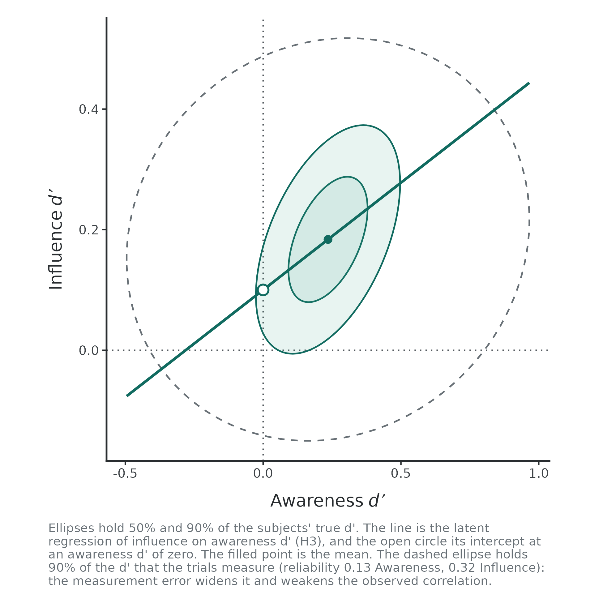
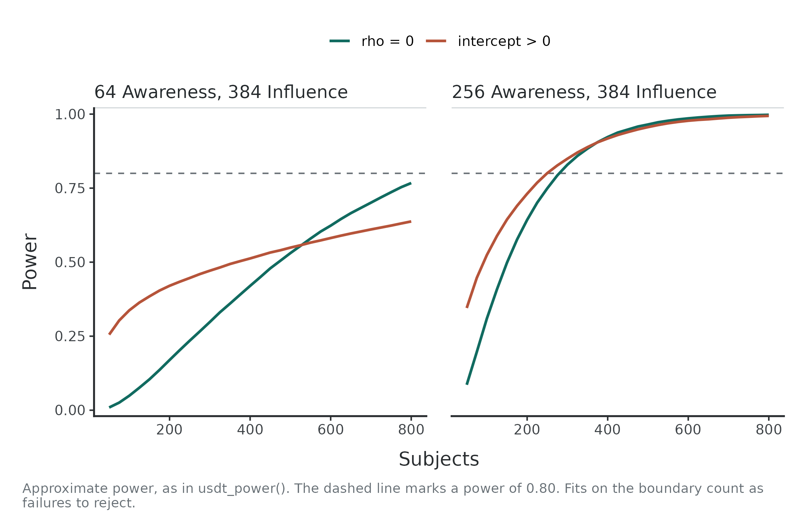
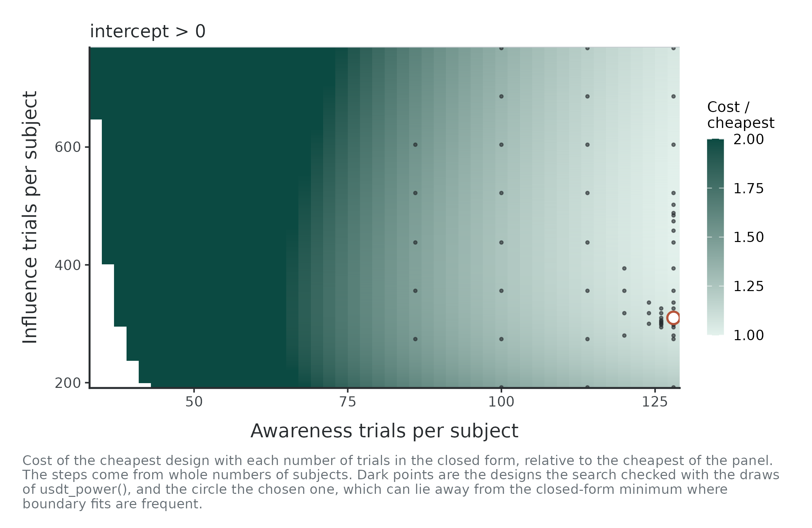
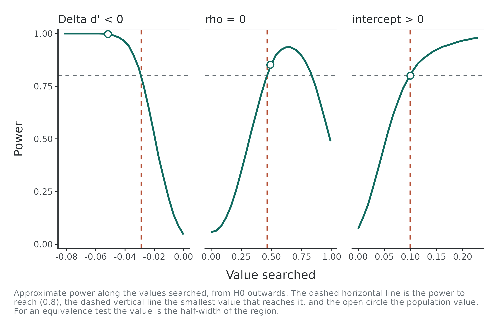
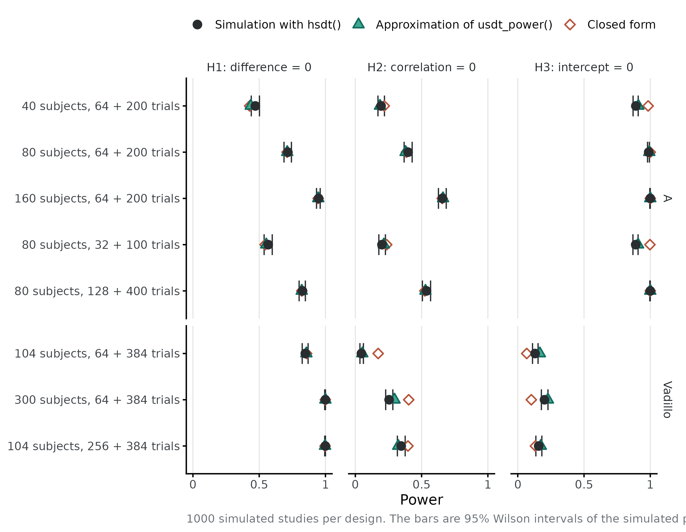

# Planning a uSDT study

``` r

library(uSDT)
```

## Three numbers to choose

A study of unconscious processing has three sizes to choose: how many
subjects, how many trials of the awareness task and how many of the
influence task. Trials affect measurement error in each subject’s
sensitivity (d'). Subjects affect the precision of population estimates.
The hypotheses depend on them in different ways:

- **H1**, the difference between mean sensitivities, gains from both
  subjects and trials, like any comparison of means.
- **H2**, the latent correlation between task sensitivities, needs
  enough trials to separate between-subject variation from measurement
  error.
- **H3**, the latent intercept, estimates influence sensitivity at zero
  awareness sensitivity. Its precision also depends on the slope.

The workflow is to specify a population, compute power, choose a
feasible design, vary assumptions and check the chosen design by
simulation.

## The population

Planning starts from the values the population is assumed to have. A
pilot study is a natural source. The data of Vadillo, Malejka and Shanks
(2025), which the package includes, serve as one here:

``` r

d <- usdt_data_tasks(
  awareness = vadillo_awareness,
  influence = vadillo_cuing,
  subject_col      = "subj",
  condition_col    = "condition",
  condition_levels = c(signal = "old", noise = "new"),
  response_col     = list(awareness = "judged.old", influence = "rt"),
  response_levels  = list(awareness = c(signal = 1, noise = 0),
                          influence = c(signal = "faster", noise = "slower")),
  dichotomize      = list(awareness = FALSE, influence = TRUE)
)
pilot <- hsdt(d)
```

[`usdt_population()`](https://ricardoreysaez.github.io/uSDT/reference/usdt_population.md)
takes the estimates of a fit with `from`, and any value given in the
call replaces the estimate. For illustration, we target an intercept of
0.1. Choose the smallest effect of interest from substantive arguments.
Neither this example nor the pilot determines it. Giving the intercept
uses the latent regression parameterization, which keeps the awareness
mean, both standard deviations and the correlation, and moves the
influence mean so that the intercept is 0.1:

``` r

pop <- usdt_population(from = pilot, intercept = 0.1)
pop
```

    ── Population ───────────────────────────────────────────── latent regression ── 

      Parameter     Awareness  Influence
      mean d'           0.235     0.184*
      sd(d')            0.122      0.088
      cor(d')           0.491           
      intercept         0.100           
      mean c           -0.036      0.000
      sd(c)             0.247      0.000

           Tested quantity                 Value
      H1   Δd' (influence - awareness)    -0.052
      H2   correlation                     0.491
      H3   intercept                       0.100
           slope                           0.356

      * The influence mean follows from the intercept: mu_I = b0 + rho (sd_I / sd_A) mu_A.
      A task split at the median has its criterion fixed at 0.

The arguments have the names of
[`usdt_priors()`](https://ricardoreysaez.github.io/uSDT/reference/usdt_priors.md)
and take numbers: `dprime`, `sd_dprime`, `cor_dprime`, `criterion`,
`sd_criterion` and `intercept`. A population can also be written from
scratch, in either parameterization, as
`usdt_population(dprime = c(awareness = 0.2, influence = 0.3), sd_dprime = 0.3, cor_dprime = 0.4)`.

The plot shows the distribution of the true d' across subjects, with the
latent regression line and its intercept. Given the trials of each task,
it adds, as a dashed ellipse, the distribution of the d' those trials
measure:

``` r

plot(pop, trials = c(awareness = 64, influence = 384), dichotomize = "influence")
```



The subjects of this population differ very little in their awareness
sensitivity (a standard deviation of 0.12), much less than 64 trials can
tell apart. The measured awareness d' spreads almost three times as
widely as the true one: the reliability of the awareness task is 0.13.
Most of what a study would see in the awareness task is measurement
error, and that is what limits H2 and H3.

## The power of a design

[`usdt_power()`](https://ricardoreysaez.github.io/uSDT/reference/usdt_power.md)
gives the power of each hypothesis for a number of subjects and of
trials per task. The hypotheses are written as in
[`usdt_equivalence()`](https://ricardoreysaez.github.io/uSDT/reference/usdt_equivalence.md),
so they can be two-sided, one-sided, equivalence or minimal-effect
tests. Here we use the pilot’s design, testing the correlation two-sided
and the difference and intercept one-sided:

``` r

usdt_power(pop, subjects = 104, trials = c(awareness = 64, influence = 384),
           hypothesis = c("diff < 0", "rho = 0", "intercept > 0"),
           dichotomize = "influence", combine = "all")
```

    ── Power ──────────────────────────────────────────────────────── approximate ── 

      Design       104 subjects; trials per subject: 64 Awareness, 384 Influence (split at the median)
      Reliability  Awareness 0.128, Influence 0.322

      Hypothesis        Test              True      SE  Estimable   Power
      H1 Δd' < 0        One-sided test  -0.052   0.035      1.000   0.421
      H2 rho = 0        Two-sided test   0.491   0.517      0.657   0.053
      H3 intercept > 0  One-sided test   0.100   0.115      0.657   0.343
      All at once       Joint test                          0.657   0.005

      Approximate power: the share of 20,000 draws of the subjects' sample
      mean and covariance in which the test rejects H0, at alpha = 0.05.

The `all` row is the probability of rejecting all three nulls in the
same study. It is not the product of their separate powers. If a
population value lies in H0, the reported rejection rate is the type I
error rate.

The pilot’s design would detect an intercept of 0.1 in one study out of
three. The `Estimable` column estimates how often the sensitivity
covariance stays off the boundary in the approximation. Non-estimable
draws count as failures to reject H2 and H3.

Several numbers of subjects and of trials give a grid of designs, and
[`plot()`](https://rdrr.io/r/graphics/plot.default.html) draws power
against the subjects:

``` r

curves <- usdt_power(pop, subjects = seq(50, 800, 25),
                     trials = list(awareness = c(64, 256), influence = 384),
                     hypothesis = c("rho = 0", "intercept > 0"),
                     dichotomize = "influence")
plot(curves)
```



Four times as many awareness trials do more for H2 and H3 than many more
subjects: they raise the reliability of the awareness task from 0.13 to
0.37.

### How the power is computed

Power uses a sampling-distribution approximation by default. Measurement
error in each subject’s d' has the variance that
[`usdt_reliability()`](https://ricardoreysaez.github.io/uSDT/reference/usdt_reliability.md)
reports, which falls with the number of trials. The measured d' of N
subjects then have a known covariance, and their sample mean and
covariance a known distribution.
[`usdt_power()`](https://ricardoreysaez.github.io/uSDT/reference/usdt_power.md)
draws sample means and covariances 20,000 times, subtracts measurement
variance, applies approximate tests and counts rejections. Invalid
sensitivity covariance estimates count as boundary outcomes for H2 and
H3. This approximates the hierarchical analysis. It does not fit a model
to each draw.

With `method = "simulation"`,
[`usdt_power()`](https://ricardoreysaez.github.io/uSDT/reference/usdt_power.md)
instead simulates whole studies, splits the influence responses at each
subject’s median as
[`meyen_split()`](https://ricardoreysaez.github.io/uSDT/reference/meyen_split.md)
does, fits each one with
[`hsdt()`](https://ricardoreysaez.github.io/uSDT/reference/hsdt.md) and
tests it. This slower method checks the chosen design below.

## Choosing subjects and trials

[`usdt_plan()`](https://ricardoreysaez.github.io/uSDT/reference/usdt_plan.md)
chooses the design. A range lets it choose a value and a single number
fixes it. With subjects and trials free, many designs reach the same
power, trading subjects for trials, and what each costs decides among
them. Here the cost is the time of the study in seconds: 600 per subject
for instructions and breaks, 5 per trial of the recognition test and 2
per trial of visual search.

``` r

plan <- usdt_plan(pop, hypothesis = "intercept > 0", power = 0.8,
                  subjects = c(50, 1000),
                  trials = list(awareness = c(32, 512), influence = c(192, 768)),
                  cost = c(subject = 600, awareness = 5, influence = 2),
                  dichotomize = "influence")
plan
```

    ── Plan ───────────────────────────────────────────── approximate · power 0.8 ── 

      Subjects     50 to 1000
      Trials       Awareness 32 to 512; Influence 192 to 768
      Cost         600 per subject + 5 per Awareness trial + 2 per Influence trial

      Target         Subjects  Awareness  Influence  Power  Estimable     Cost
      intercept > 0       102        510        762  0.802      0.996  476,748

      ! intercept > 0: the design is at the limit of `trials$awareness` and `trials$influence`; a wider range may give a cheaper one.
      Approximate power. Check the design with usdt_power(plan, method = "simulation").

The cheapest design is a small study with long tasks, and both trial
counts end at the limit of their ranges: with an awareness task this
unreliable, more trials are cheaper than more subjects. A recognition
test of 500 trials, however, may not be feasible, since testing the
displays so many times could change what is remembered. With at most 128
awareness trials:

``` r

plan <- usdt_plan(pop, hypothesis = "intercept > 0", power = 0.8,
                  subjects = c(50, 2000),
                  trials = list(awareness = c(32, 128), influence = c(192, 768)),
                  cost = c(subject = 600, awareness = 5, influence = 2),
                  dichotomize = "influence")
plan
```

    ── Plan ───────────────────────────────────────────── approximate · power 0.8 ── 

      Subjects     50 to 2000
      Trials       Awareness 32 to 128; Influence 192 to 768
      Cost         600 per subject + 5 per Awareness trial + 2 per Influence trial

      Target         Subjects  Awareness  Influence  Power  Estimable       Cost
      intercept > 0       609        128        310  0.800      0.994  1,132,740

      ! intercept > 0: the design is at the limit of `trials$awareness`; a wider range may give a cheaper one.
      Approximate power. Check the design with usdt_power(plan, method = "simulation").

``` r

plot(plan)
```



The plot shows the cost of the cheapest design for each number of
awareness trials. The grey line is the closed form that the search
starts from. The green points are the designs the search checked with
the draws of
[`usdt_power()`](https://ricardoreysaez.github.io/uSDT/reference/usdt_power.md).
The circle is the chosen one. With an unreliable awareness task the
closed form is optimistic, so the search does not trust it and checks a
lattice of designs and the neighbours of the best.

### Budget and precision targets

With fixed trials, these calls choose the number of subjects. `budget`
maximizes power within a cost limit. `precision` targets an expected
confidence interval width instead of power.

``` r

usdt_plan(pop, hypothesis = "intercept > 0", budget = 30 * 3600,
          subjects = c(50, 2000), trials = c(awareness = 128, influence = 384),
          cost = c(subject = 600, awareness = 5, influence = 2),
          dichotomize = "influence")
```

    ── Plan ───────────────────────────────────────── approximate · budget 108000 ── 

      Subjects     50 to 2000
      Trials       Awareness 128 (fixed); Influence 384 (fixed)
      Cost         600 per subject + 5 per Awareness trial + 2 per Influence trial

      Target         Subjects  Awareness  Influence  Power  Estimable     Cost
      intercept > 0        53        128        384  0.296      0.651  106,424

      ! intercept > 0: the design is at the limit of `subjects`; a wider range may give a cheaper one.
      Approximate power. Check the design with usdt_power(plan, method = "simulation").

``` r

usdt_plan(pop, precision = c(intercept = 0.2), subjects = c(50, 2000),
          trials = c(awareness = 128, influence = 384),
          dichotomize = "influence")
```

    ── Plan ───────────────────────────────────────────── approximate · precision ── 

      Subjects     50 to 2000
      Trials       Awareness 128 (fixed); Influence 384 (fixed)

      Target                  Subjects  Awareness  Influence  Width  Estimable     Cost
      intercept width <= 0.2       224        128        384  0.200      0.935      224

      Expected width of the 95% interval of usdt_tests() at the population values.

## Other assumptions

The plan rests on the population. Several values in an argument of
[`usdt_population()`](https://ricardoreysaez.github.io/uSDT/reference/usdt_population.md)
give one scenario each, and
[`update()`](https://ricardoreysaez.github.io/uSDT/reference/usdt_population.md)
changes them. With the awareness task at 128 trials and the influence
task at 384, a larger intercept or a weaker correlation than assumed
needs another number of subjects:

``` r

scenarios <- update(pop, intercept = c(0.1, 0.15), cor_dprime = c(0.3, 0.49))
usdt_plan(scenarios, hypothesis = "intercept > 0", power = 0.8,
          subjects = c(50, 3000), trials = c(awareness = 128, influence = 384),
          dichotomize = "influence")
```

    ── Plan ─────────────────────────────── approximate · power 0.8 · 4 scenarios ── 

      Subjects     50 to 3000
      Trials       Awareness 128 (fixed); Influence 384 (fixed)

      Scenario  Target         Subjects  Awareness  Influence  Power  Estimable     Cost
      1         intercept > 0       447        128        384  0.800      0.998      447
      2         intercept > 0       567        128        384  0.800      0.995      567
      3         intercept > 0       251        128        384  0.801      0.983      251
      4         intercept > 0       316        128        384  0.801      0.969      316

      Approximate power. Check the design with usdt_power(plan, method = "simulation").

An intercept of 0.15 needs about half the subjects that 0.1 needs. A
weaker correlation needs fewer subjects, not more: with a flatter slope,
the intercept depends less on how far the regression is extrapolated to
an awareness sensitivity of zero.

## The smallest effect the design detects

[`usdt_mdes()`](https://ricardoreysaez.github.io/uSDT/reference/usdt_mdes.md)
finds, for each hypothesis, the smallest effect a design detects with
the given power. It moves the tested quantity away from H0 with the rest
of the population fixed, as its parameterization says. With the chosen
design:

``` r

mdes <- usdt_mdes(pop, subjects = plan$design$subjects,
                  trials = c(awareness = plan$design$trials_awareness,
                             influence = plan$design$trials_influence),
                  hypothesis = c("diff < 0", "rho = 0", "intercept > 0"),
                  dichotomize = "influence")
mdes
```

    ── Smallest detectable effect ─────────────────────── approximate · power 0.8 ── 

      Design       609 subjects; trials per subject: 128 Awareness, 310 Influence

      Hypothesis        Varies     Population  Power there  Smallest
      H1 Δd' < 0        diff           -0.052        0.997    -0.029
      H2 rho = 0        rho             0.491        0.852     0.464
      H3 intercept > 0  intercept       0.100        0.800     0.099

      Approximate power, as in usdt_power(). NA: the power is not reached 
      in the range searched.

``` r

plot(mdes)
```



The power of H2 does not keep rising with the correlation: near 1, the
estimated correlation often reaches the boundary, where the test cannot
be run. For an equivalence test,
[`usdt_mdes()`](https://ricardoreysaez.github.io/uSDT/reference/usdt_mdes.md)
gives instead the narrowest equivalence region the design can establish.

## Checking the design by simulation

A design chosen with the approximation should be checked by simulating
it.
[`usdt_power()`](https://ricardoreysaez.github.io/uSDT/reference/usdt_power.md)
takes the plan and simulates its designs, analysing each study with
[`hsdt()`](https://ricardoreysaez.github.io/uSDT/reference/hsdt.md). The
following is optional and is not run when building the article:

``` r

check <- usdt_power(plan, method = "simulation", nsim = 1000, ncores = 4,
                    seed = 2026)
check
summary(check)
```

The report gives the simulated power with its Monte Carlo error and 95%
interval, and how many studies failed to converge.
[`summary()`](https://rdrr.io/r/base/summary.html) reports the precision
of each quantity across the simulated studies: the mean estimate and its
bias, the empirical standard error (the standard deviation of the
estimates) against the mean standard error the fits report, and the
width and coverage of the intervals. Each study has its own random
number stream, so the results do not depend on the number of cores.

## How close is the approximation?

The figure compares, for eight designs of two populations, the power of
the three point nulls from the closed form, from the approximation of
[`usdt_power()`](https://ricardoreysaez.github.io/uSDT/reference/usdt_power.md)
and from 1000 simulated studies analysed with
[`hsdt()`](https://ricardoreysaez.github.io/uSDT/reference/hsdt.md).
Population A is a plausible case of unconscious processing, with
reliabilities from 0.4 to 0.85. The Vadillo population has an awareness
reliability of 0.13 with 64 trials.



For these designs, H1 agrees across methods. For H2 and H3, the closed
form diverges when awareness reliability is low because it ignores
boundary outcomes. The sampling-distribution approximation follows the
simulation more closely, but remains somewhat optimistic for the Vadillo
population. Check chosen designs by simulation, particularly with low
reliability.

The approximation assumes equal signal/noise variances. To check
sensitivity to unequal variances, set `sd_signal` in
[`usdt_population()`](https://ricardoreysaez.github.io/uSDT/reference/usdt_population.md)
and use `method = "simulation"`. Those studies are still analysed with
the **equal-variance** frequentist model.

## Summary

| Question | Function |
|----|----|
| What population do I assume? | [`usdt_population()`](https://ricardoreysaez.github.io/uSDT/reference/usdt_population.md), from values or from a pilot fit |
| What power does my design have? | [`usdt_power()`](https://ricardoreysaez.github.io/uSDT/reference/usdt_power.md) |
| How many subjects, trials, or both? | [`usdt_plan()`](https://ricardoreysaez.github.io/uSDT/reference/usdt_plan.md), with `cost`, `budget` or `precision` |
| What if my assumptions are wrong? | several values in [`usdt_population()`](https://ricardoreysaez.github.io/uSDT/reference/usdt_population.md) or [`update()`](https://rdrr.io/r/stats/update.html) |
| What is the smallest effect I can detect? | [`usdt_mdes()`](https://ricardoreysaez.github.io/uSDT/reference/usdt_mdes.md) |
| Does the chosen design hold up? | `usdt_power(plan, method = "simulation")` and [`summary()`](https://rdrr.io/r/base/summary.html) |

## References

Vadillo, M. A., Malejka, S., & Shanks, D. R. (2025). Mapping the
reliability multiverse of contextual cuing. *Journal of Experimental
Psychology: Learning, Memory, and Cognition*, 51(6), 910-927.
<https://doi.org/10.1037/xlm0001410>
