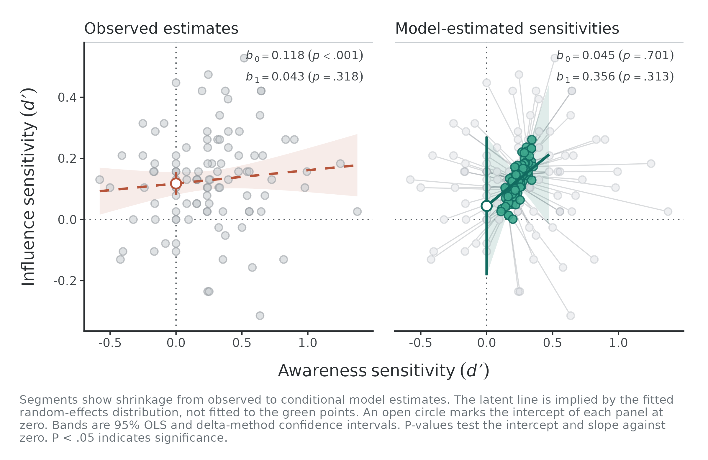
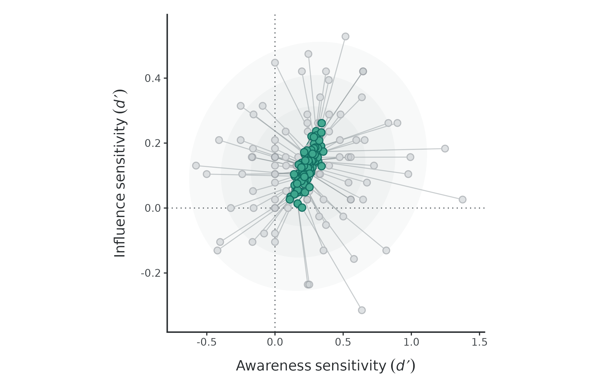
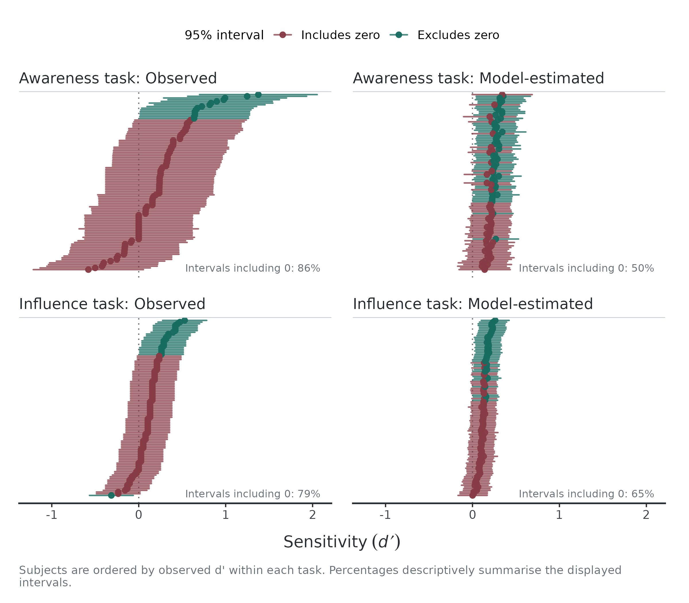
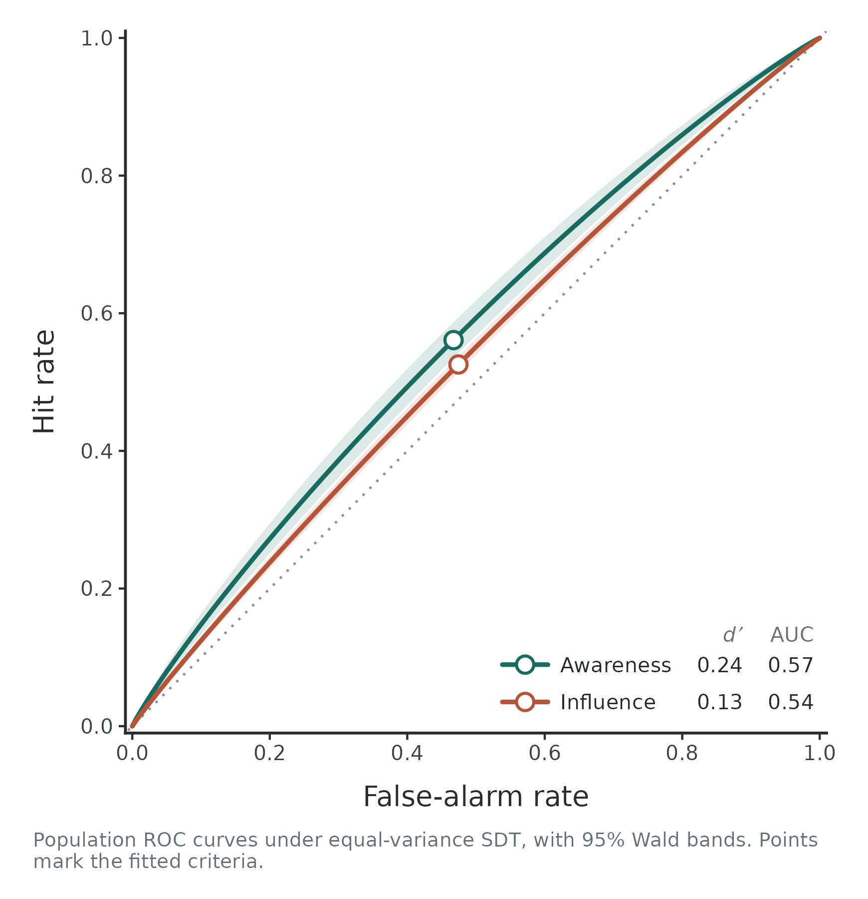
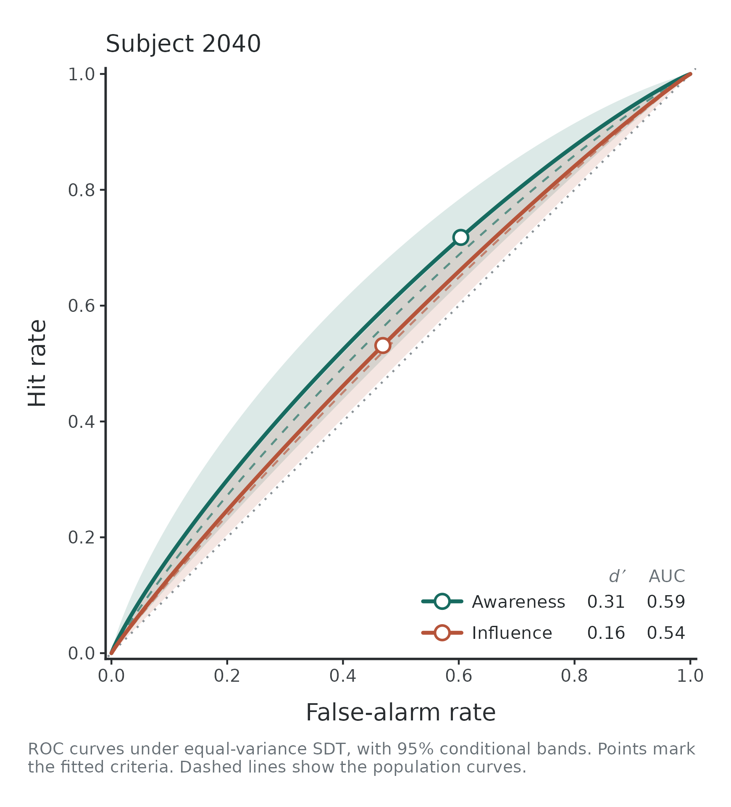

# Fitting a hierarchical SDT model

``` r

library(uSDT)
```

## What is uSDT for?

uSDT models paired **awareness** and **influence** measures from the
same participants. It estimates their mean sensitivities,
between-subject variation and latent association. The latent regression
estimates influence sensitivity at zero awareness sensitivity.
Interpreting this as unconscious processing requires a suitable model
and an adequate awareness measure.

Prepare the data with
[`usdt_data_tasks()`](https://ricardoreysaez.github.io/uSDT/reference/usdt_data.md),
fit with
[`hsdt()`](https://ricardoreysaez.github.io/uSDT/reference/hsdt.md),
then inspect the tests, plots and reliability.

## The data

The package includes Experiment 2 of [Vadillo, Malejka, and Shanks
(2025)](https://doi.org/10.1037/xlm0001410). `vadillo_awareness`
contains old/new recognition judgements. `vadillo_cuing` contains search
response times. Contextual cuing predicts faster responses to repeated
(`old`) displays.

``` r

head(vadillo_awareness)
```

      subj               file trial pattId judgm judged.old condition    offset
    1 2001 y109b_subj1051.mat     1   1001     1          0       old no offset
    2 2001 y109b_subj1051.mat     2   1002     5          1       old no offset
    3 2001 y109b_subj1051.mat     3   3005     4          1       new    offset
    4 2001 y109b_subj1051.mat     4   3006     5          1       new    offset
    5 2001 y109b_subj1051.mat     5   3001     2          0       new no offset
    6 2001 y109b_subj1051.mat     6   1006     4          1       old    offset
      color   set.size
    1 color set size 8
    2   b/w set size 8
    3 color set size 8
    4   b/w set size 8
    5 color set size 8
    6   b/w set size 8

``` r

head(vadillo_cuing)
```

        experiment subj               file trial block epoch pattId acc       rt
    1 Experiment 2 2001 y109b_subj1051.mat     1     1     1   2001   1 1305.352
    2 Experiment 2 2001 y109b_subj1051.mat     2     1     1   1008   1 4027.887
    3 Experiment 2 2001 y109b_subj1051.mat     3     1     1   1007   1 2484.210
    4 Experiment 2 2001 y109b_subj1051.mat     4     1     1   2006   1 1771.315
    5 Experiment 2 2001 y109b_subj1051.mat     5     1     1   1001   1  926.236
    6 Experiment 2 2001 y109b_subj1051.mat     6     1     1   1006   1 1194.542
      condition    offset color    set.size
    1       new no offset color  set size 8
    2       old    offset   b/w set size 16
    3       old    offset color set size 16
    4       new    offset   b/w  set size 8
    5       old no offset color  set size 8
    6       old    offset   b/w  set size 8

Subject IDs link participants across tasks. Individual trials need not
be paired. Column names and condition labels may differ between tasks.

This example uses all supplied trials, including search errors, across
blocks and display conditions. It demonstrates the package workflow
using the source data. Define exclusions and select the relevant trials
before dichotomizing. The package does not remove errors or RT outliers
automatically.

## Preparing the data

[`usdt_data_tasks()`](https://ricardoreysaez.github.io/uSDT/reference/usdt_data.md)
takes one data frame per task. Give shared arguments once and
task-specific arguments as `list(awareness = ..., influence = ...)`.

``` r

data_usdt <- usdt_data_tasks(
  awareness = vadillo_awareness,
  influence = vadillo_cuing,
  subject_col      = "subj",
  condition_col    = "condition",
  condition_levels = c(signal = "old", noise = "new"),
  response_col     = list(awareness = "judged.old", influence = "rt"),
  response_levels  = list(
    awareness = c(signal = 1, noise = 0),
    influence = c(signal = "faster", noise = "slower")
  ),
  dichotomize = list(awareness = FALSE, influence = TRUE)
)
```

The median split is computed **within subject, pooling conditions**
(Meyen et al., 2022). RTs below the median become signal responses. Ties
become noise responses by default. A hit is an old display searched
faster than the median. A false alarm is a new display searched faster
than the median. The resulting d' measures discrimination by this binary
classifier.

With balanced signal/noise trials and an exact half split, the classical
criterion is zero under the default deviation coding. Ties, odd trial
counts or unequal condition counts can change this.
[`hsdt()`](https://ricardoreysaez.github.io/uSDT/reference/hsdt.md)
fixes a dichotomized task’s criterion to zero when its mean absolute
subject criterion is below 0.02. `fix_criteria = "none"` estimates all
criteria.

`coding = "deviation"` codes signal/noise as +0.5/-0.5, so the probit
intercept is -c. Treatment coding uses 1/0, giving the intercept
z(FAR)=-\lambda, where \lambda=c+d'/2. Both define sensitivity as
d'=z(HR)-z(FAR). They specify different random-effects models when
criteria and sensitivities are constrained to independent blocks, so
fitted sensitivities need not be identical.

``` r

data_usdt
```

    ── Data summary ──────────────────────────────────────────────────────────────── 

      Input:          2 data frames (usdt_data_tasks)
      Subjects:       104 (104 in both tasks, 0 in one only)
      Trials:         46,592 -> 416 aggregated rows (4 per subject)
      Coding:         deviation (condition coded -0.5 / +0.5; intercept estimates -c)
      Parameters:     7 (3 fixed effects, 4 (co)variance components)

    ── Variable mapping ────────────────────────────────────────────────────────────

      Variable       Task       Column          Signal        Noise
      subject        Awareness  subj            -             -
                     Influence  subj            -             -
      condition      Awareness  condition       old           new
                     Influence  condition       old           new
      response       Awareness  judged.old      1             0
                     Influence  rt              faster        slower  [Meyen split]

    ── Descriptives: median [min, max] across subjects ─────────────────────────────

      Task       Trials/cell                  HR                 FAR   d' (method-of-moments)
      Awareness           32    .56 [ .28,  .88]    .47 [ .12,  .78]    0.24 [-0.58,  1.38]
      Influence          192    .53 [ .44,  .60]    .47 [ .40,  .56]    0.13 [-0.31,  0.53]

      No cells at floor or ceiling.

Check subject overlap, role mappings, trial counts and extreme rates.
The model uses two binomial rows per task and subject (signal and
noise), four rows per subject here. Extreme rates are fitted directly.
Descriptive d' values use the Hautus correction where needed.

For a single long-format frame, use
[`usdt_data_long()`](https://ricardoreysaez.github.io/uSDT/reference/usdt_data.md)
with `task_col` and `task_levels = c(awareness = "A", influence = "I")`.

## Fitting the model

[`hsdt()`](https://ricardoreysaez.github.io/uSDT/reference/hsdt.md) fits
a binomial probit mixed model by maximum likelihood with the Laplace
approximation in lme4.

``` r

fit_uSDT <- hsdt(data_usdt)
summary(fit_uSDT)
```

    ── Model summary ─────────────────────────────────────────────────────────────── 

      Subjects:       104
      Observations:   416 aggregated rows (46,592 trials)
      Family:         binomial (probit)
      Coding:         deviation
      Criteria:       Awareness estimated, Influence fixed to 0 (Meyen split, mean |c| = 0.0000)
      Estimation:     lme4::glmer (Nelder_Mead), tried bobyqa -> Nelder_Mead
      Convergence:    TRUE

    ── Fixed effects ───────────────────────────────────────────────────────────────

      Parameter      Task       Estimate       SE  95% CI                   z   p-value
      criterion      Awareness   -0.0357   0.0289  [ -0.092,  0.021]    -1.24      .215
      d'             Awareness    0.2354   0.0335  [  0.170,  0.301]     7.03     <.001
      d'             Influence    0.1283   0.0153  [  0.098,  0.158]     8.41     <.001

    ── Random effects ──────────────────────────────────────────────────────────────

      Parameter      Task       Estimate       SE  95% CI            
      sd(criterion)  Awareness    0.2473   0.0246  [  0.204,  0.301]
      sd(d')         Awareness    0.1219   0.0666  [  0.042,  0.356]
      sd(d')         Influence    0.0883   0.0190  [  0.058,  0.135]
      cor(d')        both         0.4910   0.5188  [ -0.665,  0.954]

    ── Hypotheses ──────────────────────────────────────────────────────────────────

    H1: Group-level sensitivity difference (Δd' = Influence d' - Awareness d')
      Parameter       Estimate       SE  95% CI                   z   p-value
      Δd' (I - A)     -0.1071   0.0354  [ -0.176, -0.038]    -3.03      .002

    H2: Correlation between sensitivities across tasks
      Parameter       Estimate       SE  95% CI                   z   p-value
      rho               0.4910   0.5188  [ -0.665,  0.954]     1.01      .313

    H3: Latent regression of Influence d' on Awareness d'
      Parameter       Estimate       SE  95% CI                   z   p-value
      Intercept         0.0445   0.1159  [ -0.183,  0.272]     0.38      .701
      Slope             0.3558   0.4865  [ -0.598,  1.309]     1.01      .313

    ── Notes ───────────────────────────────────────────────────────────────────────

      Use usdt_boot(fit, nsim = 1000, ncores = 4) for bootstrap CIs.

Fixed sensitivity effects are task means. Random effects describe
subject departures. `sd(d')` measures between-subject variation and
`cor(d')` the latent correlation. Subject estimates combine the fixed
effects with conditional random-effect modes. Inspect convergence and
singularity before interpreting the tests.

### The three hypotheses

The default tests are two-sided against zero, without multiplicity
adjustment.

- **H1, mean difference:** \Delta d'=\mu_I-\mu_A (influence minus
  awareness). Here it is -0.11, 95% CI \[-0.18, -0.04\]. The interval is
  below zero, favouring awareness sensitivity. An influence advantage
  would require a positive difference. Its interpretation also depends
  on how the tasks measure conscious information.
- **H2, latent correlation:** \rho= 0.49, 95% CI \[-0.67, 0.95\]. This
  describes the association between latent subject sensitivities. The
  wide interval provides little precision. A nonsignificant test does
  not establish independence.
- **H3, latent regression:** the slope is 0.36 and the intercept is
  0.04, 95% CI \[-0.18, 0.27\]. The intercept is expected influence
  sensitivity at **latent awareness sensitivity zero**, not the mean of
  participants selected for low observed scores. Its interval includes
  zero, leaving both zero and positive influence sensitivity compatible
  with these data.

Writing the awareness variance as \tau_A^2 and the covariance as
\tau\_{AI},

E(d'\_I\mid d'\_A=x)=\beta_0+\beta_1 x,\qquad
\beta_1=\tau\_{AI}/\tau_A^2,\qquad \beta_0=\mu_I-\beta_1\mu_A.

A positive intercept requires an adequate awareness measure and a
suitable latent model to support an unconscious-processing
interpretation. It may involve extrapolation to zero. The analytical
tests of H2 and the H3 slope share a covariance test, so they provide
the same test of association.

### Equivalence and one-sided tests

[`usdt_equivalence()`](https://ricardoreysaez.github.io/uSDT/reference/usdt_equivalence.md)
tests specified bounds. Choose them from theory or previous studies.
These only illustrate the syntax.

``` r

usdt_equivalence(fit_uSDT, c("diff in [-0.2, 0.2]", "intercept < 0.2",
                            "rho in [-0.3, 0.3]"))
```

     uSDT hypothesis ─ Equivalence test (TOST)
    ════════════════════════════════════════════════════════════════════════════════
      Hypothesis (H1)             : Δd' in [-0.2, 0.2]
      Hypothesis (H0)             : Δd' out [-0.2, 0.2]
      Estimate                    : -0.107
      Standard error              : 0.035
      90% CI, Wald                : [-0.165, -0.049]
      p-value, lower bound        : .004
      p-value, upper bound        : <.001
      p-value                     : .004
      Decision (alpha = 0.05)     : H0 rejected, in favour of H1
    ────────────────────────────────────────────────────────────────────────────────

     uSDT hypothesis ─ One-sided test
    ════════════════════════════════════════════════════════════════════════════════
      Hypothesis (H1)             : intercept < 0.2
      Hypothesis (H0)             : intercept >= 0.2
      Estimate                    : 0.045
      Standard error              : 0.116
      90% CI, Wald                : [-0.146, 0.235]
      p-value                     : .090
      Decision (alpha = 0.05)     : H0 not rejected
    ────────────────────────────────────────────────────────────────────────────────

     uSDT hypothesis ─ Equivalence test (TOST)
    ════════════════════════════════════════════════════════════════════════════════
      Hypothesis (H1)             : rho in [-0.3, 0.3]
      Hypothesis (H0)             : rho out [-0.3, 0.3]
      Estimate                    : 0.491
      Standard error              : 0.519
      90% CI, Fisher-z            : [-0.528, 0.930]
      p-value, lower bound        : .108
      p-value, upper bound        : .631
      p-value                     : .631
      Decision (alpha = 0.05)     : H0 not rejected
    ────────────────────────────────────────────────────────────────────────────────

At \alpha=.05, equivalence and one-sided tests report 90% intervals.
Here the sensitivity difference is equivalent within \pm0.2 despite
being different from zero. The intercept and correlation tests do not
establish their proposed bounds. Correlation tests use the Fisher-z
scale, so their p-values can differ from the covariance test in
[`usdt_tests()`](https://ricardoreysaez.github.io/uSDT/reference/usdt_hypotheses.md).

## Reliability of individual differences

[`usdt_reliability()`](https://ricardoreysaez.github.io/uSDT/reference/usdt_reliability.md)
estimates \tau^2/(\tau^2+\overline v) for each task: between-subject
sensitivity variance divided by total variance, with measurement
variance \overline v from binomial-probit information at the fitted
probabilities.

``` r

reliability <- usdt_reliability(fit_uSDT)
reliability
```

    ── Reliability summary ───────────────────────────────────────────────────────── 

      Task         Subjects Group-level estimate   By-subject estimate median [min, max]
      Awareness         104                 .129   .130 [.119, .131]
      Influence         104                 .323   .323 [.322, .323]

Reliability is about .13 for awareness and .32 for influence. Low
reliability can reflect little between-subject variation, substantial
trial noise, or both. It limits precision for individual differences
even when the mean effect is clear. The latent model accounts for trial
noise under its assumptions. It does not guarantee unbiased or precise
estimates in every sample.

``` r

head(reliability$subjects)
```

           task subj    dprime   variance reliability
    1 Awareness 2001 0.2707158 0.09899329   0.1305303
    2 Awareness 2002 0.2485344 0.10427183   0.1247468
    3 Awareness 2003 0.2172227 0.10017561   0.1291888
    4 Awareness 2004 0.3175901 0.09908306   0.1304275
    5 Awareness 2005 0.1444059 0.10037191   0.1289687
    6 Awareness 2006 0.1733233 0.09926175   0.1302232

## Visualizing the model

### Latent regression and shrinkage

``` r

plot(fit_uSDT)
```



The left panel regresses observed influence d' on observed awareness d'.
Measurement error in the predictor can flatten the slope. The right
panel draws the latent regression implied by the fitted covariance, with
segments connecting observed pairs to their conditional model estimates.
The line is not fitted through those partially pooled points. Its band
is a pointwise confidence interval for the regression mean.

Use `nrow = 2` to stack the panels and `caption = FALSE` to hide the
caption. The shrinkage plot isolates the movement of the subject
estimates:

``` r

plot(fit_uSDT, type = "shrinkage")
```



### Subject intervals

``` r

plot(fit_uSDT, type = "caterpillar")
```



Observed intervals use Miller standard errors and a normal
approximation. Model intervals include uncertainty in the means,
variance components and subject effects when the joint covariance is
available. The percentages describe intervals containing zero. They do
not classify participants as aware or unaware.

### ROC curves

``` r

plot(fit_uSDT, type = "roc")
```



These equal-variance SDT curves describe a subject whose random effects
are set to zero. Points mark fitted criteria and bands transform the
sensitivity intervals. Binary responses identify one operating point per
task. The full curves follow from the model.

``` r

plot(fit_uSDT, type = "roc", subject_id = 2040)
```



Subject curves use partially pooled estimates, with population curves
dashed behind them. Their bands condition on the fitted population
parameters.

## Further analyses

[`usdt_boot()`](https://ricardoreysaez.github.io/uSDT/reference/usdt_boot.md)
adds parametric bootstrap inference to a frequentist fit:

``` r

fit_boot <- usdt_boot(fit_uSDT, nsim = 1000, ncores = 4, seed = 2026)
summary(fit_boot)
fit_boot$tests
```

At least 500 usable replicates are required before bootstrap inference
replaces the analytical results. Converged boundary refits are retained
when all hypothesis estimates are finite. Inspect failures and retained
boundary counts in `fit_boot$boot`. The bootstrap simulates binary
responses at the original cell sizes. It does not repeat the RT median
split or resolve a lack of information in the design. Read the returned
`$tests` table to retain bootstrap results.
[`usdt_tests()`](https://ricardoreysaez.github.io/uSDT/reference/usdt_hypotheses.md)
recomputes analytical tests.

[Bayesian
estimation](https://ricardoreysaez.github.io/uSDT/articles/uSDT-bayesian.md)
covers priors, posterior summaries and Bayes factors with
`hsdt(estimation = "bayesian")`. [Planning a
study](https://ricardoreysaez.github.io/uSDT/articles/uSDT-power.md)
covers power, sample sizes and detectable effects. For covariates, see
the custom lme4 and brms examples in
[`usdt_tests()`](https://ricardoreysaez.github.io/uSDT/reference/usdt_hypotheses.md).

## References

Meyen, S., Zerweck, I. A., Amado, C., von Luxburg, U., & Franz, V. H.
(2022). Advancing research on unconscious priming: When can scientists
claim an indirect task advantage? *Journal of Experimental Psychology:
General*, 151(1), 65-81. <https://doi.org/10.1037/xge0001065>

Vadillo, M. A., Malejka, S., & Shanks, D. R. (2025). Mapping the
reliability multiverse of contextual cuing. *Journal of Experimental
Psychology: Learning, Memory, and Cognition*, 51(6), 910-927.
<https://doi.org/10.1037/xlm0001410>
