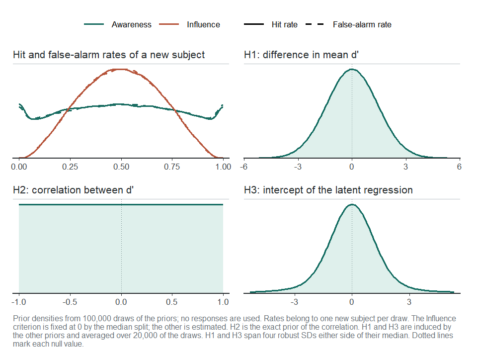
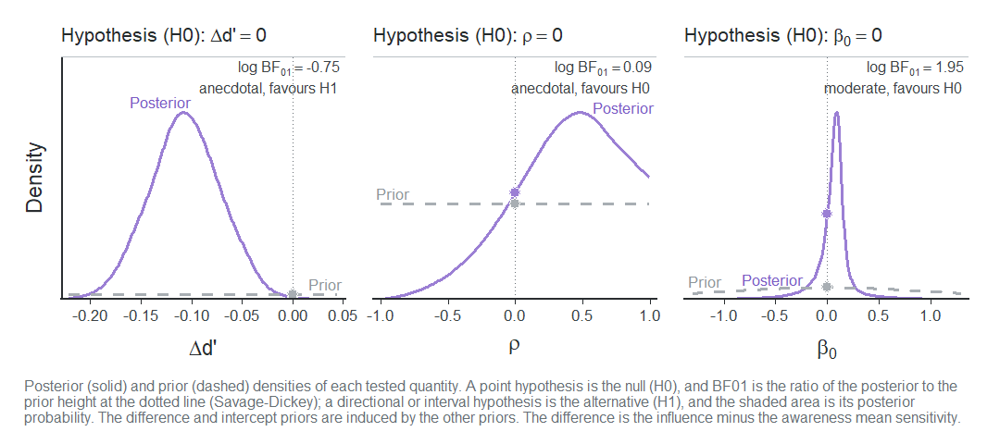
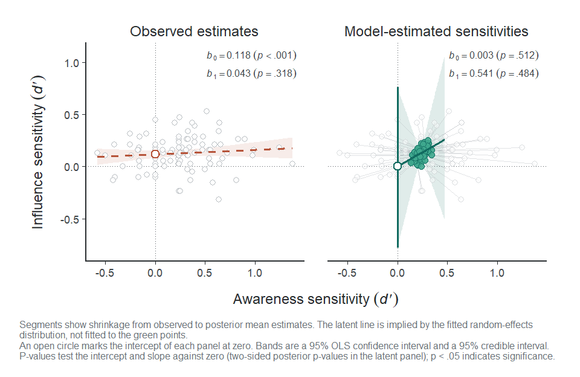
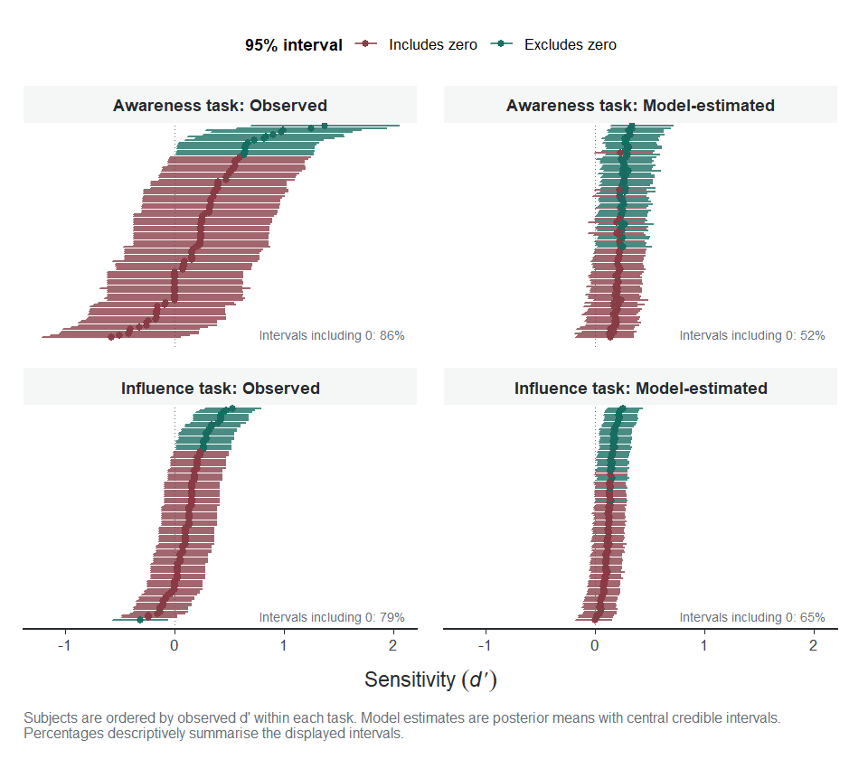
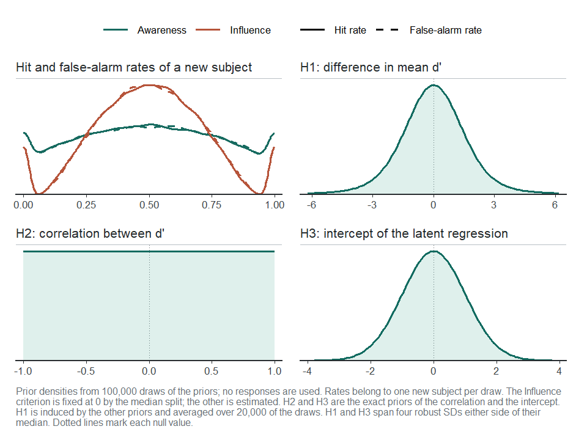

<!-- This vignette is precomputed, because fitting the model takes too long
for CRAN. Edit uSDT-bayesian.Rmd.orig and, from the vignettes folder,
run knitr::knit("uSDT-bayesian.Rmd.orig", "uSDT-bayesian.Rmd"). -->


``` r
library(uSDT)
```

This article fits the [tutorial's model and data](uSDT-tutorial.html) with
brms and Stan, then summarises the posterior and computes Bayes factors.

Bayesian fitting needs a C++ toolchain and either rstan (with `BH` and
`RcppEigen`) or cmdstanr with CmdStan. The `brms.backend` option selects the
backend. The default is rstan and this article uses cmdstanr. Compiled models
are cached for later sessions.

## The data

We use the paired data exactly as the tutorial prepares them:


``` r
data_usdt <- usdt_data_tasks(
  awareness = vadillo_awareness,
  influence = vadillo_cuing,
  subject_col      = "subj",
  condition_col    = "condition",
  condition_levels = c(signal = "old", noise = "new"),
  response_col     = list(awareness = "judged.old", influence = "rt"),
  response_levels  = list(awareness = c(signal = 1, noise = 0),
                          influence = c(signal = "faster", noise = "slower")),
  dichotomize      = list(awareness = FALSE, influence = TRUE)
)
```

## Choosing the priors

[`usdt_priors()`](../reference/usdt_priors.html) specifies the priors. Each
prior is a string in Stan notation, and the defaults are weakly informative on
the probit scale:


``` r
priors <- usdt_priors()
priors
```

```
── Priors ────────────────────────────────────────────────────────────────────── 

  Parameter    Task       Prior
  mean d'      awareness  normal(0, 1)
  mean d'      influence  normal(0, 1)
  sd(d')       awareness  student_t(4, 0, 0.5)
  sd(d')       influence  student_t(4, 0, 0.5)
  cor(d')      both       lkj(1)
  mean c       awareness  normal(0, 0.5)
  mean c       influence  normal(0, 0.5)
  sd(c)        awareness  student_t(4, 0, 0.5)
  sd(c)        influence  student_t(4, 0, 0.5)
  cor(c)       both       lkj(1)
  sd(signal)   awareness  lognormal(0, 0.5)
  sd(signal)   influence  lognormal(0, 0.5)
  intercept    both       normal(0, 1)

  Standard deviation priors are truncated at zero. cor(c) applies when
  both criteria are estimated, and sd(signal) under unequal variances.
  Under the latent regression, intercept replaces the influence mean d'.
```

- **Means of $d'$ and of the criterion:** normal priors centred at zero,
  `normal(0, 1)` for $d'$ and `normal(0, 0.5)` for $c$.
- **Between-subject standard deviations:** Student-$t$ priors truncated at
  zero, `student_t(4, 0, 0.5)`.
- **Correlations:** `lkj(1)`, a uniform prior on $(-1, 1)$. Larger values of
  its argument concentrate the correlation around zero.
- **Intercept:** used only by the latent regression parameterization, at the
  end of this article, in place of the prior of the influence mean.

Supported families are listed in [`usdt_priors()`](../reference/usdt_priors.html).
Means need full real-line support. SDs need positive support or truncation at
zero.

The model only uses the priors of the parameters it estimates. Here the
median split fixes the influence criterion at zero and both tasks have equal
variances, so the influence criterion, the criterion correlation and the signal
standard deviations play no role.

### Checking what the priors imply

Before fitting anything, `plot()` simulates the priors to show what they say
about the data and the hypotheses:


``` r
plot(priors, data = data_usdt)
```

<div class="figure" style="text-align: center">

<p class="caption">plot of chunk prior-check</p>
</div>

- **Hit and false-alarm rates (top left):** the rates of a new subject spread
  over the whole $(0, 1)$ range without piling up at either end. The influence
  rates are more concentrated because the median split fixes their criterion.
- **H1 and H2 (top right, bottom left):** the priors of $\Delta d'$, a
  normal centred at zero, and of $\rho$, uniform.
- **H3 (bottom right):** the intercept of the latent regression has no prior
  of its own. Its prior follows from those of the means, standard deviations
  and correlation, and is symmetric around zero with heavy tails.

To change a prior, pass its new value to `usdt_priors()`, either for both
tasks or per task, and the result to `hsdt()`:


``` r
priors_custom <- usdt_priors(
  dprime    = list(awareness = "normal(0, 1)", influence = "normal(0, 0.5)"),
  sd_dprime = "gamma(2, 4)"
)
hsdt(data_usdt, estimation = "bayesian", priors = priors_custom)
```

## Fitting the model

Setting `estimation = "bayesian"` in [`hsdt()`](../reference/hsdt.html) fits
the model with brms:


``` r
fit_bayes <- hsdt(data_usdt, estimation = "bayesian", seed = 2026)
```

Defaults are four chains, each with 1,000 warmup iterations and 5,000 kept
draws. Inspect divergences, tree-depth warnings, R-hat and effective sample
size before interpreting the fit. Sampling options include `chains`, `iter`
(including warmup), `warmup`, `cores`, `seed` and `control`. `backend` selects
the Stan interface.

The summary has the same structure as the frequentist one:


``` r
summary(fit_bayes)
```

```
── Model summary ─────────────────────────────────────────────────────────────── 

  Subjects:       104
  Observations:   416 aggregated rows (46,592 trials)
  Family:         binomial (probit), equal variances
  Criteria:       Awareness estimated, Influence fixed to 0 (Meyen split, mean |c| = 0.0000)
  Estimation:     brms via cmdstanr, 4 chains x 5,000 draws (warmup 1,000)
  Diagnostics:    max R-hat 1.002, min ESS 1,880, 0 divergent
```

```
Loading required namespace: rstan
```

```

── Fixed effects ───────────────────────────────────────────────────────────────

  Parameter      Task           Mean       SD  95% CrI             R-hat     ESS
  criterion      Awareness   -0.0356   0.0289  [ -0.092,  0.021]   1.000   9,191
  d'             Awareness    0.2350   0.0330  [  0.170,  0.300]   1.000  32,301
  d'             Influence    0.1283   0.0153  [  0.098,  0.158]   1.000  26,275

── Random effects ──────────────────────────────────────────────────────────────

  Parameter      Task           Mean       SD  95% CrI             R-hat     ESS
  sd(criterion)  Awareness    0.2513   0.0249  [  0.205,  0.303]   1.000   9,337
  sd(d')         Awareness    0.1073   0.0597  [  0.006,  0.224]   1.000   4,354
  sd(d')         Influence    0.0864   0.0219  [  0.039,  0.127]   1.000   5,186
  cor(d')        both         0.2902   0.4448  [ -0.740,  0.954]   1.002   1,880

── Hypotheses ──────────────────────────────────────────────────────────────────

H1: Group-level sensitivity difference (Δd' = Influence d' - Awareness d')
  Parameter           Mean       SD  95% CrI            p-value
  Δd' (I - A)     -0.1067   0.0358  [ -0.177, -0.036]     .002

H2: Correlation between sensitivities across tasks
  Parameter           Mean       SD  95% CrI            p-value
  rho               0.2902   0.4448  [ -0.740,  0.954]     .484

H3: Latent regression of Influence d' on Awareness d'
  Parameter           Mean       SD  95% CrI            p-value
  Intercept         0.0026   7.9765  [ -0.780,  0.761]     .512
  Slope             0.5406  34.1561  [ -2.712,  3.862]     .484

── Priors ──────────────────────────────────────────────────────────────────────

  Parameter    Task       Prior
  mean d'      Awareness  normal(0, 1)
  mean d'      Influence  normal(0, 1)
  sd(d')       Awareness  student_t(4, 0, 0.5)
  sd(d')       Influence  student_t(4, 0, 0.5)
  cor(d')      both       lkj(1)
  mean c       Awareness  normal(0, 0.5)
  sd(c)        Awareness  student_t(4, 0, 0.5)

── Notes ───────────────────────────────────────────────────────────────────────

  Mean, SD and CrI are the posterior mean, posterior SD and central
  credible interval. The p-value is the two-sided posterior p-value.
```


Estimates are posterior means, with posterior SDs and central 95% credible
intervals (CrIs). Mean sensitivities are $d' = 0.24$
in the awareness task and $d' = 0.13$ in
the influence task.

### The brms fit

`fit_bayes$fit` is a `brmsfit`. Its non-linear parameters include `dA` and
`dI` (sensitivities) and `cA` (the classical awareness criterion). Inspect
their priors with:


``` r
prior_table <- brms::prior_summary(fit_bayes$fit)
prior_table[prior_table$source == "user", ]
```

```
                prior class coef  group resp dpar nlpar lb ub tag source
 lkj_corr_cholesky(1)     L        subj                             user
       normal(0, 0.5)     b                          cA             user
         normal(0, 1)     b                          dA             user
         normal(0, 1)     b                          dI             user
 student_t(4, 0, 0.5)    sd        subj              dA             user
 student_t(4, 0, 0.5)    sd        subj              dI             user
 student_t(4, 0, 0.5)    sd      subj_c              cA             user
```

Criteria use a separate subject block, `subj_c`. Check model adequacy with
posterior predictive comparisons as well as sampler diagnostics:


``` r
brms::pp_check(fit_bayes$fit)
```

## The three hypotheses

The p-value of each hypothesis is now the **two-sided posterior p-value**,
$2 \min\{P(\theta > 0 \mid y), P(\theta < 0 \mid y)\}$. It falls below .05
when the central 95% credible interval excludes zero (up to finite-draw
rounding). This is posterior sign uncertainty, not a frequentist p-value or
a Bayes factor.

- **H1 ($\Delta d'$):** awareness of the repeated patterns is again stronger
  than their influence on search
  ($\Delta d' = -0.11$, 95% CrI
  $[-0.18, -0.04]$, $p = .002$), the same
  conclusion as in the tutorial.
- **H2 ($\rho$):** the posterior of the latent correlation spans almost the
  whole range (95% CrI $[-0.74, 0.95]$). The data say little about it.
- **H3 (latent regression):** the 95% credible interval of the intercept
  covers zero ($[-0.78, 0.76]$). Its posterior mean
  ($0.00$) and standard deviation
  ($7.98$) are dominated by heavy tails: the awareness
  sensitivity barely varies across subjects
  ($\text{sd}(d') = 0.11$),
  so the slope $\rho \, \sigma_I / \sigma_A$ can take very large values. With
  posteriors like this one, emphasise the credible interval.

## Bayes factors

A credible interval that covers zero does not show that an effect is absent.
[`usdt_bf()`](../reference/usdt_bf.html) weighs the evidence for and against
each hypothesis. By default, it tests the three point nulls with the
Savage-Dickey density ratio and draws the prior and posterior of each tested
quantity:


``` r
set.seed(2026)
bf <- usdt_bf(fit_bayes)
```

<div class="figure" style="text-align: center">

<p class="caption">plot of chunk bf</p>
</div>

``` r
bf
```

```
 uSDT hypothesis ─ Savage-Dickey density ratio test
════════════════════════════════════════════════════════════════════════════════
  Hypothesis (H1)             : Δd' != 0
  Hypothesis (H0)             : Δd' = 0
  Posterior mean              : -0.107
  Posterior SD                : 0.036
  95% CrI                     : [-0.177, -0.036]
  log BF10                    : 0.809
  log BF01                    : -0.809
  Evidence                    : anecdotal for H1
────────────────────────────────────────────────────────────────────────────────

 uSDT hypothesis ─ Savage-Dickey density ratio test
════════════════════════════════════════════════════════════════════════════════
  Hypothesis (H1)             : rho != 0
  Hypothesis (H0)             : rho = 0
  Posterior mean              : 0.290
  Posterior SD                : 0.445
  95% CrI                     : [-0.740, 0.954]
  log BF10                    : -0.151
  log BF01                    : 0.151
  Evidence                    : anecdotal for H0
────────────────────────────────────────────────────────────────────────────────

 uSDT hypothesis ─ Savage-Dickey density ratio test
════════════════════════════════════════════════════════════════════════════════
  Hypothesis (H1)             : intercept != 0
  Hypothesis (H0)             : intercept = 0
  Posterior mean              : 0.003
  Posterior SD                : 7.976
  95% CrI                     : [-0.780, 0.761]
  log BF10                    : -1.909
  log BF01                    : 1.909
  Evidence                    : moderate for H0
────────────────────────────────────────────────────────────────────────────────
```

A point statement names H0. An inequality or region names H1. Reports give
both log Bayes factors. Each plot panel reports evidence for the hypothesis
in its title: BF01 for a point null, BF10 for a direction or region.

- **$\Delta d' = 0$:** the evidence for a difference is anecdotal
  ($\log \text{BF}_{01} = -0.81$,
  $\text{BF}_{10} = 2.2$), even though the credible
  interval excludes zero. The Bayes factor compares the posterior with the
  whole prior, and a $\text{normal}(0, 1)$ prior on each mean expects much
  larger differences than $-0.11$.
- **$\rho = 0$:** the evidence is anecdotal
  ($\log \text{BF}_{01} = 0.15$).
- **Intercept $\beta_0 = 0$:** there is moderate evidence for the
  null ($\log \text{BF}_{01} = 1.91$,
  $\text{BF}_{01} = 6.7$) under these priors. This compares
  the zero latent intercept with its specified alternative. It does not
  identify individual participants without awareness.

Solid curves show posteriors and dashed curves priors. For a point null,
BF01 is posterior density divided by prior density at the dotted line.
Use `usdt_bf(..., plot = FALSE)` to compute without drawing, then `plot(bf)`
to draw later. `caption = FALSE` hides the caption.

You can also test directional hypotheses and regions, such as a region of
practical equivalence around zero:


``` r
set.seed(2026)
bf_other <- usdt_bf(fit_bayes, c("intercept > 0", "diff in [-0.1, 0.1]"),
                    plot = FALSE)
bf_other
```

```
 uSDT hypothesis ─ Directional test
════════════════════════════════════════════════════════════════════════════════
  Hypothesis (H1)             : intercept > 0
  Hypothesis (H0)             : intercept <= 0
  Posterior mean              : 0.003
  Posterior SD                : 7.976
  95% CrI                     : [-0.780, 0.761]
  Posterior probability (H1)  : 0.744
  log BF10                    : 1.067
  log BF01                    : -1.067
  Evidence                    : anecdotal for H1
────────────────────────────────────────────────────────────────────────────────

 uSDT hypothesis ─ Interval test
════════════════════════════════════════════════════════════════════════════════
  Hypothesis (H1)             : Δd' in [-0.1, 0.1]
  Hypothesis (H0)             : Δd' out [-0.1, 0.1]
  Posterior mean              : -0.107
  Posterior SD                : 0.036
  95% CrI                     : [-0.177, -0.036]
  Posterior probability (H1)  : 0.421
  log BF10                    : 2.503
  log BF01                    : -2.503
  Evidence                    : strong for H1
────────────────────────────────────────────────────────────────────────────────
```


These Bayes factors compare the posterior odds of H1, the share of posterior
draws inside it, with its prior odds. A positive intercept has a posterior
probability of .744 against
.500 a priori, which is anecdotal evidence.
The region $[-0.1, 0.1]$ holds 42% of the
posterior but only about 6% of the prior, so the
Bayes factor is strong
($\log \text{BF}_{10} = 2.50$) even though the
posterior mean lies just outside it. Read interval Bayes factors together
with the posterior probability.

Bayes factors depend on the priors. Report the priors and check sensitivity
to other defensible choices by refitting. Changing prior width need not have
the same effect for every hypothesis.

## Visualizing the posterior

All the plots of the tutorial work with a Bayesian fit, and show posterior
means with credible intervals.

### The latent regression


``` r
plot(fit_bayes)
```

<div class="figure" style="text-align: center">

<p class="caption">plot of chunk plot-regression</p>
</div>

The left panel is unchanged. In the right panel, the latent line uses the
posterior means, and its 95% credible band fans out away from the group means
because the slope is so uncertain. The vertical segment at
$d'_{\text{Awareness}} = 0$ is the credible interval of the intercept.

### Subject intervals


``` r
plot(fit_bayes, type = "caterpillar")
```

<div class="figure" style="text-align: center">

<p class="caption">plot of chunk plot-caterpillar</p>
</div>

The right panels show each participant's posterior mean $d'$ with its 95%
credible interval. Partial pooling pulls the estimates towards the group mean
and narrows their intervals. `type = "shrinkage"` and `type = "roc"` work as
in the tutorial.

## The latent regression parameterization

The intercept of H3 has no prior of its own above: the model places its
priors on the means, standard deviations and correlation of the two
sensitivities, and the intercept prior they induce has very heavy tails. Its
Bayes factor depends on all of them. With
`latent = "regression"`, the prior of the influence mean moves to the
intercept $\beta_0$ of the latent regression, the last row of
`usdt_priors()`. The influence mean follows from it as
$\mu_I = \beta_0 + \rho \, (\sigma_I / \sigma_A) \, \mu_A$, and the priors of
the awareness mean, the standard deviations and the correlation do not change.

When $\sigma_A$ approaches zero, the ratio $\sigma_I/\sigma_A$ can produce
difficult posterior geometry. A prior that gives less weight near zero can
help, if substantively justified. Here we use `gamma(2, 4)` for $\sigma_A$
and retain the default for $\sigma_I$:


``` r
priors_reg <- usdt_priors(sd_dprime = list(awareness = "gamma(2, 4)",
                                           influence = "student_t(4, 0, 0.5)"))
plot(priors_reg, data = data_usdt, latent = "regression")
```

<div class="figure" style="text-align: center">

<p class="caption">plot of chunk prior-check-regression</p>
</div>

H3 now has the specified intercept prior (default `normal(0, 1)`), while H1
has the induced prior
$\Delta d' = \beta_0 + (\rho\,\sigma_I/\sigma_A-1)\mu_A$.
Inspect both the hypothesis and predictive implications: this choice changes
the prior model, even though it reports the same quantities.


``` r
fit_reg <- hsdt(data_usdt, estimation = "bayesian", priors = priors_reg,
                latent = "regression", seed = 2026)
```

The model samples the same parameters as before, so the fit reports the same
tables and hypotheses, and its header names the parameterization:


``` r
summary(fit_reg)
```

```
── Model summary ─────────────────────────────────────────────────────────────── 

  Subjects:       104
  Observations:   416 aggregated rows (46,592 trials)
  Family:         binomial (probit), equal variances
  Model:          latent regression of Influence d' on Awareness d'
  Criteria:       Awareness estimated, Influence fixed to 0 (Meyen split, mean |c| = 0.0000)
  Estimation:     brms via cmdstanr, 4 chains x 5,000 draws (warmup 1,000)
  Diagnostics:    max R-hat 1.002, min ESS 2,578, 0 divergent

── Fixed effects ───────────────────────────────────────────────────────────────

  Parameter      Task           Mean       SD  95% CrI             R-hat     ESS
  criterion      Awareness   -0.0357   0.0294  [ -0.094,  0.021]   1.001   9,838
  d'             Awareness    0.2345   0.0343  [  0.167,  0.301]   1.000  34,365
  d'             Influence    0.1282   0.0154  [  0.098,  0.158]   1.001  25,396

── Random effects ──────────────────────────────────────────────────────────────

  Parameter      Task           Mean       SD  95% CrI             R-hat     ESS
  sd(criterion)  Awareness    0.2515   0.0254  [  0.205,  0.305]   1.000   8,970
  sd(d')         Awareness    0.1330   0.0529  [  0.034,  0.238]   1.001   6,784
  sd(d')         Influence    0.0866   0.0213  [  0.041,  0.126]   1.000   6,732
  cor(d')        both         0.3342   0.4010  [ -0.560,  0.954]   1.002   2,578

── Hypotheses ──────────────────────────────────────────────────────────────────

H1: Group-level sensitivity difference (Δd' = Influence d' - Awareness d')
  Parameter           Mean       SD  95% CrI            p-value
  Δd' (I - A)     -0.1062   0.0368  [ -0.178, -0.034]     .004

H2: Correlation between sensitivities across tasks
  Parameter           Mean       SD  95% CrI            p-value
  rho               0.3342   0.4010  [ -0.560,  0.954]     .402

H3: Latent regression of Influence d' on Awareness d'
  Parameter           Mean       SD  95% CrI            p-value
  Intercept         0.0653   0.1236  [ -0.204,  0.266]     .365
  Slope             0.2695   0.5224  [ -0.568,  1.421]     .402

── Priors ──────────────────────────────────────────────────────────────────────

  Parameter    Task       Prior
  mean d'      Awareness  normal(0, 1)
  sd(d')       Awareness  gamma(2, 4)
  sd(d')       Influence  student_t(4, 0, 0.5)
  cor(d')      both       lkj(1)
  mean c       Awareness  normal(0, 0.5)
  sd(c)        Awareness  student_t(4, 0, 0.5)
  intercept    both       normal(0, 1)

── Notes ───────────────────────────────────────────────────────────────────────

  Mean, SD and CrI are the posterior mean, posterior SD and central
  credible interval. The p-value is the two-sided posterior p-value.
```


$\Delta d' = -0.11$ (95% CrI $[-0.18, -0.03]$)
as before. The intercept, with a prior of its own and $\sigma_A$ kept away
from zero, has the 95% credible interval $[-0.20, 0.27]$, against
$[-0.78, 0.76]$ when its prior was induced by the others.

The interval of $\rho$ is now $[-0.56, 0.95]$, against
$[-0.74, 0.95]$ before. Both the intercept prior and the SD prior changed.
This comparison does not isolate either one's effect. The intercept prior
also affects the correlation posterior and Bayes factor:


``` r
set.seed(2026)
usdt_bf(fit_reg, c("intercept = 0", "rho = 0"), plot = FALSE)
```

```
 uSDT hypothesis ─ Savage-Dickey density ratio test
════════════════════════════════════════════════════════════════════════════════
  Hypothesis (H1)             : intercept != 0
  Hypothesis (H0)             : intercept = 0
  Posterior mean              : 0.065
  Posterior SD                : 0.124
  95% CrI                     : [-0.204, 0.266]
  log BF10                    : -1.752
  log BF01                    : 1.752
  Evidence                    : moderate for H0
────────────────────────────────────────────────────────────────────────────────

 uSDT hypothesis ─ Savage-Dickey density ratio test
════════════════════════════════════════════════════════════════════════════════
  Hypothesis (H1)             : rho != 0
  Hypothesis (H0)             : rho = 0
  Posterior mean              : 0.334
  Posterior SD                : 0.401
  95% CrI                     : [-0.560, 0.954]
  log BF10                    : -0.185
  log BF01                    : 0.185
  Evidence                    : anecdotal for H0
────────────────────────────────────────────────────────────────────────────────
```

## Where to go from here

### Reliability

[`usdt_reliability()`](../reference/usdt_reliability.html) returns the
posterior of each task's reliability:


``` r
reliability <- usdt_reliability(fit_bayes)
reliability
```

```
── Reliability summary ───────────────────────────────────────────────────────── 

  Task         Subjects Group mean       SD  95% CrI              By-subject mean median [min, max]
  Awareness         104       .118     .096  [  0.000,  0.331]    .119 [.110, .120]
  Influence         104       .311     .102  [  0.086,  0.495]    .311 [.310, .312]

  Means, SDs and credible intervals summarise the posterior draws.
```

The posterior means (.118 and
.311) are close to the frequentist
estimates, and the credible intervals show how uncertain they are: the
reliability of the awareness task could be anywhere between
0.00 and
.331.

### Unequal signal and noise variances

`unequal_variances = TRUE` is available for Bayesian fits:


``` r
fit_uv <- hsdt(data_usdt, estimation = "bayesian",
               unequal_variances = TRUE, seed = 2026)
```

With one binary operating point per task, signal SDs are weakly identified,
so check prior sensitivity. H1–H3 then use the separation $d$ in noise-SD
units. To compare discriminability across different signal SDs, transform
each draw to $d_a=d\sqrt{2/(1+\sigma_s^2)}$. See
[`hsdt()`](../reference/hsdt.html). The equal-variance tutorial does not
fit this extension.

### Custom models fitted with brms

When you need covariates, you can fit your own model with `brms` and test it
with the same functions. [`usdt_aggregate()`](../reference/usdt_aggregate.html)
counts the trials first, which makes the fit much faster. `usdt_bf()` reads
the priors from the model, so the two sensitivities need proper priors from
the families of `usdt_priors()`:


``` r
trials <- rbind(
  data.frame(vadillo_awareness[c("subj", "condition", "set.size")],
             task = "A", resp = vadillo_awareness$judged.old),
  data.frame(vadillo_cuing[c("subj", "condition", "set.size")],
             task = "I", resp = meyen_split(vadillo_cuing$rt,
                                            by = vadillo_cuing$subj))
)
trials <- within(trials, {
  cond <- ifelse(condition == "old", 0.5, -0.5)
  size <- ifelse(set.size == "set size 16", 0.5, -0.5)
  awareness <- as.integer(task == "A")
})
counts <- usdt_aggregate(trials, response = "resp",
                         by = c("subj", "task", "cond", "size", "awareness"))

fit_brms <- brms::brm(
  y | trials(n) ~ 0 + awareness + task:size + task:cond +
    (0 + awareness | subj) + (0 + task:cond | subj),
  data = counts, family = binomial("probit"),
  prior = brms::prior(normal(0, 1), class = b)
)
usdt_tests(fit_brms, awareness = "taskA:cond", influence = "taskI:cond")
usdt_bf(fit_brms, awareness = "taskA:cond", influence = "taskI:cond")
```

The examples of [`usdt_tests()`](../reference/usdt_hypotheses.html) build
`counts` from the Vadillo data with set size as a covariate.

## References

Vadillo, M. A., Malejka, S., & Shanks, D. R. (2025). Mapping the reliability
multiverse of contextual cuing. *Journal of Experimental Psychology: Learning,
Memory, and Cognition*, 51(6), 910-927. <https://doi.org/10.1037/xlm0001410>

Wagenmakers, E.-J., Lodewyckx, T., Kuriyal, H., & Grasman, R. (2010). Bayesian
hypothesis testing for psychologists: A tutorial on the Savage-Dickey method.
*Cognitive Psychology*, 60(3), 158-189.
<https://doi.org/10.1016/j.cogpsych.2009.12.001>


