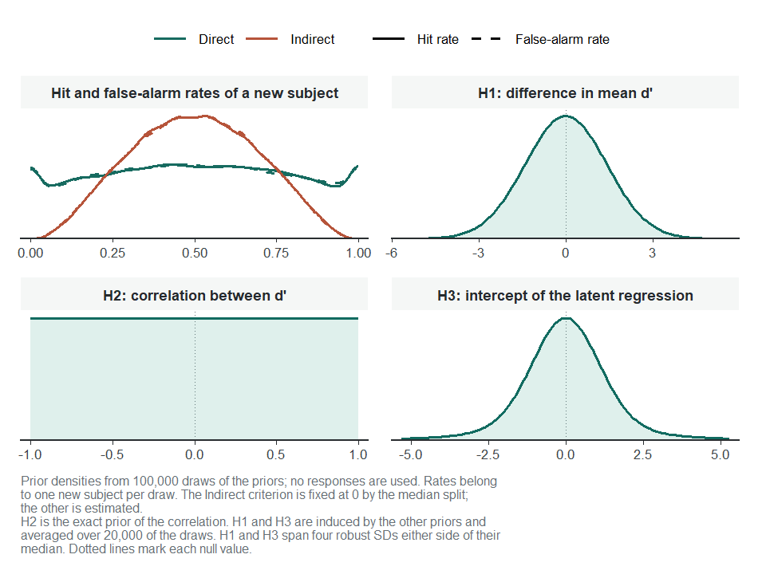
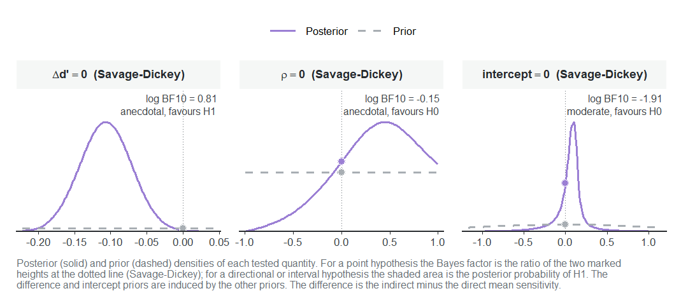
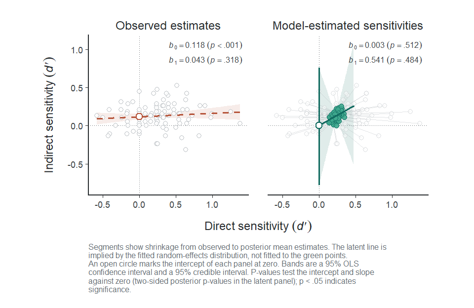
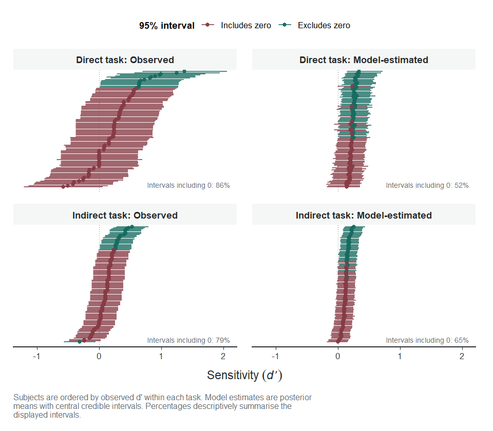
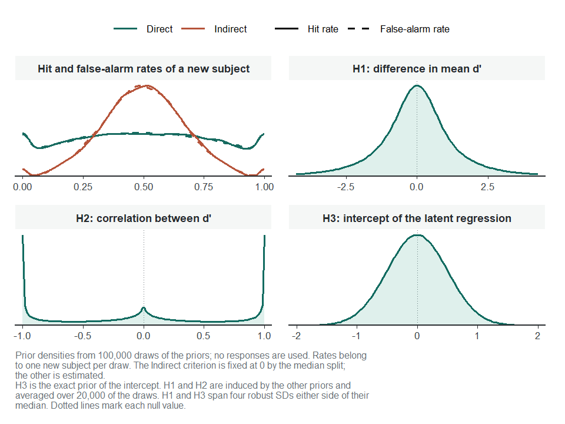

<!-- This vignette is precomputed, because fitting the model takes too long
for CRAN. Edit uSDT-bayesian.Rmd.orig and, from the vignettes folder,
run knitr::knit("uSDT-bayesian.Rmd.orig", "uSDT-bayesian.Rmd"). -->


``` r
library(uSDT)
```

The [tutorial](uSDT-tutorial.html) fits the hierarchical SDT model by maximum
likelihood. This article fits the same model to the same contextual cuing data
in a Bayesian framework. The data, the model and the three hypotheses do not
change. What changes is that you place **priors** on the parameters, the model
is fitted with [brms](https://paulbuerkner.com/brms/), which draws from the
**posterior** with Stan, and you can weigh each hypothesis with **Bayes
factors**.

uSDT installs `brms`, which fits the model with a Stan backend: `rstan`
(which also needs `BH` and `RcppEigen`) or `cmdstanr`. As in brms, the backend is the
`brms.backend` option, rstan when it is not set; this article was built with
`options(brms.backend = "cmdstanr")`. The model is compiled the first time
you fit it with a given set of priors, which needs a C++ toolchain and takes
a minute or so, and it is cached for later sessions.

## The data

We use the paired data exactly as the tutorial prepares them:


``` r
data_usdt <- usdt_data_tasks(
  direct   = vadillo_awareness,
  indirect = vadillo_cuing,
  subject_col      = "subj",
  condition_col    = "condition",
  condition_levels = c(signal = "old", noise = "new"),
  response_col     = list(direct = "judged.old", indirect = "rt"),
  response_levels  = list(direct   = c(signal = 1, noise = 0),
                          indirect = c(signal = "faster", noise = "slower")),
  dichotomize      = list(direct = FALSE, indirect = TRUE)
)
```

## Choosing the priors

[`usdt_priors()`](../reference/usdt_priors.html) specifies the priors. Each
prior is a string in Stan notation, and the defaults are weakly informative on
the probit scale:


``` r
priors <- usdt_priors()
priors
```

```
── Priors ────────────────────────────────────────────────────────────────────── 

  Parameter    Task       Prior
  mean d'      direct     normal(0, 1)
  mean d'      indirect   normal(0, 1)
  sd(d')       direct     student_t(4, 0, 0.5)
  sd(d')       indirect   student_t(4, 0, 0.5)
  cor(d')      both       lkj(1)
  mean c       direct     normal(0, 0.5)
  mean c       indirect   normal(0, 0.5)
  sd(c)        direct     student_t(4, 0, 0.5)
  sd(c)        indirect   student_t(4, 0, 0.5)
  cor(c)       both       lkj(1)
  sd(signal)   direct     lognormal(0, 0.5)
  sd(signal)   indirect   lognormal(0, 0.5)
  intercept    both       normal(0, 1)

  Standard deviation priors are truncated at zero. cor(c) applies when
  both criteria are estimated, and sd(signal) under unequal variances.
  Under the latent regression, intercept replaces the indirect mean d'.
```

- **Means of $d'$ and of the criterion:** normal priors centred at zero,
  `normal(0, 1)` for $d'$ and `normal(0, 0.5)` for $c$.
- **Between-subject standard deviations:** Student-$t$ priors truncated at
  zero, `student_t(4, 0, 0.5)`.
- **Correlations:** `lkj(1)`, a uniform prior on $(-1, 1)$. Larger values of
  its argument concentrate the correlation around zero.
- **Intercept:** used only by the latent regression parameterization, at the
  end of this article, in place of the prior of the indirect mean.

Any Stan distribution that covers the values of its parameter works: one on
the whole real line for a mean, such as `student_t(5, 0, 1)` or
`skew_normal(0, 1, 2)`, and for a standard deviation also one on the positive
values, such as `gamma(2, 4)` or `lognormal(-1, 0.5)`.

The model only uses the priors of the parameters it estimates. Here the
median split fixes the indirect criterion at zero and both tasks have equal
variances, so the indirect criterion, the criterion correlation and the signal
standard deviations play no role.

### Checking what the priors imply

Before fitting anything, `plot()` simulates the priors to show what they say
about the data and the hypotheses:


``` r
plot(priors, data = data_usdt)
```

<div class="figure" style="text-align: center">

<p class="caption">plot of chunk prior-check</p>
</div>

- **Hit and false-alarm rates (top left):** the rates of a new subject spread
  over the whole $(0, 1)$ range without piling up at either end. The indirect
  rates are more concentrated because the median split fixes their criterion.
- **H1 and H2 (top right, bottom left):** the priors of $\Delta d'$, a
  normal centred at zero, and of $\rho$, uniform.
- **H3 (bottom right):** the intercept of the latent regression has no prior
  of its own. Its prior follows from those of the means, standard deviations
  and correlation, and is symmetric around zero with heavy tails.

To change a prior, pass its new value to `usdt_priors()`, either for both
tasks or per task, and the result to `hsdt()`:


``` r
priors_custom <- usdt_priors(
  dprime    = list(direct = "normal(0, 1)", indirect = "normal(0, 0.5)"),
  sd_dprime = "gamma(2, 4)"
)
hsdt(data_usdt, estimation = "bayesian", priors = priors_custom)
```

## Fitting the model

Setting `estimation = "bayesian"` in [`hsdt()`](../reference/hsdt.html) fits
the model with brms:


``` r
fit_bayes <- hsdt(data_usdt, estimation = "bayesian", seed = 2026)
── Fitting the Bayesian hierarchical SDT model ───────────────────── cmdstanr ──
ℹ 4 chains of 5000 draws after 1000 warmup iterations, 4 at a time.
✔ Sampled 4 chains in 1m 20s.
✔ No divergent transitions.
✔ No transition reached the maximum tree depth (10).
✔ Largest R-hat 1.002, below 1.01.
✔ Smallest effective sample size 1880, above 400.
```

By default, four chains keep 5,000 draws each after 1,000 warmup iterations,
and up to four of them run at once, leaving two cores of your machine free.
In the console, a progress bar shows the warmup and sampling phases while they
run. When they finish, the model reports its convergence checks:

- **Divergent transitions and maximum tree depth:** signs that the sampler
  could not explore the posterior well.
- **R-hat:** values above 1.01 suggest that the chains have not mixed.
- **Effective sample size:** values below 400 suggest too few independent
  draws for stable summaries.

Here all four checks pass. Sampling options such as `chains`, `iter`,
`warmup`, `cores`, `seed` and `control` go through `...`, and `backend`
chooses rstan or cmdstanr.

The summary has the same structure as the frequentist one:


``` r
summary(fit_bayes)
```

```
── Model summary ─────────────────────────────────────────────────────────────── 

  Subjects:       104
  Observations:   416 aggregated rows (46,592 trials)
  Family:         binomial (probit), equal variances
  Criteria:       Direct estimated, Indirect fixed to 0 (Meyen split, mean |c| = 0.0000)
  Estimation:     brms via cmdstanr, 4 chains x 5,000 draws (warmup 1,000)
  Diagnostics:    max R-hat 1.002, min ESS 1,880, 0 divergent

── Fixed effects ───────────────────────────────────────────────────────────────

  Parameter      Task           Mean       SD  95% CrI             R-hat     ESS
  criterion      Direct      -0.0356   0.0289  [ -0.092,  0.021]   1.000   9,191
  d'             Direct       0.2350   0.0330  [  0.170,  0.300]   1.000  32,301
  d'             Indirect     0.1283   0.0153  [  0.098,  0.158]   1.000  26,275

── Random effects ──────────────────────────────────────────────────────────────

  Parameter      Task           Mean       SD  95% CrI             R-hat     ESS
  sd(criterion)  Direct       0.2513   0.0249  [  0.205,  0.303]   1.000   9,337
  sd(d')         Direct       0.1073   0.0597  [  0.006,  0.224]   1.000   4,354
  sd(d')         Indirect     0.0864   0.0219  [  0.039,  0.127]   1.000   5,186
  cor(d')        both         0.2902   0.4448  [ -0.740,  0.954]   1.002   1,880

── Hypotheses ──────────────────────────────────────────────────────────────────

H1: Group-level sensitivity difference (Δd' = Indirect d' - Direct d')
  Parameter           Mean       SD  95% CrI            p-value
  Δd' (I - D)     -0.1067   0.0358  [ -0.177, -0.036]     .002

H2: Correlation between sensitivities across tasks
  Parameter           Mean       SD  95% CrI            p-value
  rho               0.2902   0.4448  [ -0.740,  0.954]     .484

H3: Latent regression of Indirect d' on Direct d'
  Parameter           Mean       SD  95% CrI            p-value
  Intercept         0.0026   7.9765  [ -0.780,  0.761]     .512
  Slope             0.5406  34.1561  [ -2.712,  3.862]     .484

── Priors ──────────────────────────────────────────────────────────────────────

  Parameter    Task       Prior
  mean d'      Direct     normal(0, 1)
  mean d'      Indirect   normal(0, 1)
  sd(d')       Direct     student_t(4, 0, 0.5)
  sd(d')       Indirect   student_t(4, 0, 0.5)
  cor(d')      both       lkj(1)
  mean c       Direct     normal(0, 0.5)
  sd(c)        Direct     student_t(4, 0, 0.5)

── Notes ───────────────────────────────────────────────────────────────────────

  Mean, SD and CrI are the posterior mean, posterior SD and central
  credible interval. The p-value is the two-sided posterior p-value.
```


Each estimate is now the **posterior mean**, with its **posterior standard
deviation** and a 95% **credible interval** (CrI), and R-hat and effective
sample size are reported for every parameter. The fixed and random effects
closely match the frequentist ones: $d' = 0.24$
in the direct task and $d' = 0.13$ in
the indirect task.

### The brms fit

`fit_bayes$fit` is the `brmsfit` itself, so every brms function works on it,
from `pp_check()` to `loo()`. The model has one non-linear parameter per
quantity: `dD` and `dI` are the $d'$ of each task, `cD` the direct criterion
(on the classical scale), and each has one prior of its own, so the prior
table of brms lists them task by task:


``` r
prior_table <- brms::prior_summary(fit_bayes$fit)
prior_table[prior_table$source == "user", ]
```

```
                prior class coef  group resp dpar nlpar lb ub tag source
       normal(0, 0.5)     b                          cD             user
         normal(0, 1)     b                          dD             user
         normal(0, 1)     b                          dI             user
 lkj_corr_cholesky(1)     L        subj                             user
 student_t(4, 0, 0.5)    sd        subj              dD             user
 student_t(4, 0, 0.5)    sd        subj              dI             user
 student_t(4, 0, 0.5)    sd      subj_c              cD             user
```

The criteria vary over `subj_c`, a copy of the subject column, so that brms
gives them a correlation prior of their own when both are estimated.

## The three hypotheses

The p-value of each hypothesis is now the **two-sided posterior p-value**,
$2 \min\{P(\theta > 0 \mid y), P(\theta < 0 \mid y)\}$. It falls below .05
exactly when the 95% credible interval excludes zero.

- **H1 ($\Delta d'$):** direct recognition is again stronger than indirect
  cuing ($\Delta d' = -0.11$, 95% CrI
  $[-0.18, -0.04]$, $p = .002$), the same
  conclusion as in the tutorial.
- **H2 ($\rho$):** the posterior of the latent correlation spans almost the
  whole range (95% CrI $[-0.74, 0.95]$). The data say little about it.
- **H3 (latent regression):** the 95% credible interval of the intercept
  covers zero ($[-0.78, 0.76]$). Its posterior mean
  ($0.00$) and standard deviation
  ($7.98$) are dominated by heavy tails: the direct
  sensitivity barely varies across subjects
  ($\text{sd}(d') = 0.11$),
  so the slope $\rho \, \sigma_I / \sigma_D$ can take very large values. With
  posteriors like this one, read the credible interval rather than the mean
  and standard deviation.

## Bayes factors

A credible interval that covers zero does not show that an effect is absent.
[`usdt_bf()`](../reference/usdt_bf.html) weighs the evidence for and against
each hypothesis. By default, it tests the three point nulls with the
Savage-Dickey density ratio and draws the prior and posterior of each tested
quantity:


``` r
set.seed(2026)
bf <- usdt_bf(fit_bayes)
```

<div class="figure" style="text-align: center">

<p class="caption">plot of chunk bf</p>
</div>

``` r
bf
```

```
 uSDT hypothesis ─ Savage-Dickey density ratio test
════════════════════════════════════════════════════════════════════════════════
  Hypothesis (H1)             : Δd' != 0
  Hypothesis (H0)             : Δd' = 0
  Posterior mean              : -0.107
  Posterior SD                : 0.036
  95% CrI                     : [-0.177, -0.036]
  log BF10                    : 0.809
  Evidence                    : anecdotal for H1
────────────────────────────────────────────────────────────────────────────────

 uSDT hypothesis ─ Savage-Dickey density ratio test
════════════════════════════════════════════════════════════════════════════════
  Hypothesis (H1)             : rho != 0
  Hypothesis (H0)             : rho = 0
  Posterior mean              : 0.290
  Posterior SD                : 0.445
  95% CrI                     : [-0.740, 0.954]
  log BF10                    : -0.151
  Evidence                    : anecdotal for H0
────────────────────────────────────────────────────────────────────────────────

 uSDT hypothesis ─ Savage-Dickey density ratio test
════════════════════════════════════════════════════════════════════════════════
  Hypothesis (H1)             : intercept != 0
  Hypothesis (H0)             : intercept = 0
  Posterior mean              : 0.003
  Posterior SD                : 7.976
  95% CrI                     : [-0.780, 0.761]
  log BF10                    : -1.909
  Evidence                    : moderate for H0
────────────────────────────────────────────────────────────────────────────────
```

- **$\Delta d' = 0$:** the evidence for a difference is anecdotal
  ($\log \text{BF}_{10} = 0.81$,
  $\text{BF}_{10} = 2.2$), even though the credible
  interval excludes zero. The Bayes factor compares the posterior with the
  whole prior, and a $\text{normal}(0, 1)$ prior on each mean expects much
  larger differences than $-0.11$.
- **$\rho = 0$:** the evidence is anecdotal
  ($\log \text{BF}_{10} = -0.15$).
- **Intercept $= 0$:** there is moderate evidence for the null
  ($\log \text{BF}_{10} = -1.91$,
  $\text{BF}_{01} = 6.7$). The data favour no indirect
  sensitivity in participants without direct sensitivity, which the credible
  interval alone could not tell.

In the plot, the solid curve is the posterior and the dashed curve the prior.
For a point null, the Bayes factor is the ratio between the two marked
heights at the dotted line.

You can also test directional hypotheses and regions, such as a region of
practical equivalence around zero:


``` r
set.seed(2026)
bf_other <- usdt_bf(fit_bayes, c("intercept > 0", "diff in [-0.1, 0.1]"),
                    plot = FALSE)
bf_other
```

```
 uSDT hypothesis ─ Directional test
════════════════════════════════════════════════════════════════════════════════
  Hypothesis (H1)             : intercept > 0
  Hypothesis (H0)             : intercept <= 0
  Posterior mean              : 0.003
  Posterior SD                : 7.976
  95% CrI                     : [-0.780, 0.761]
  Posterior probability (H1)  : 0.744
  log BF10                    : 1.067
  Evidence                    : anecdotal for H1
────────────────────────────────────────────────────────────────────────────────

 uSDT hypothesis ─ Interval test
════════════════════════════════════════════════════════════════════════════════
  Hypothesis (H1)             : Δd' in [-0.1, 0.1]
  Hypothesis (H0)             : Δd' out [-0.1, 0.1]
  Posterior mean              : -0.107
  Posterior SD                : 0.036
  95% CrI                     : [-0.177, -0.036]
  Posterior probability (H1)  : 0.421
  log BF10                    : 2.503
  Evidence                    : strong for H1
────────────────────────────────────────────────────────────────────────────────
```


These Bayes factors compare the posterior odds of H1, the share of posterior
draws inside it, with its prior odds. A positive intercept has a posterior
probability of .744 against
.500 a priori, which is anecdotal evidence.
The region $[-0.1, 0.1]$ holds 42% of the
posterior but only about 6% of the prior, so the
Bayes factor is strong
($\log \text{BF}_{10} = 2.50$) even though the
posterior mean lies just outside it. Read interval Bayes factors together
with the posterior probability.

Bayes factors depend on the priors: a wider prior puts less density at the
null value and favours the null. Report them with the priors you used, and
check that other reasonable priors lead to the same conclusion.

## Visualizing the posterior

All the plots of the tutorial work with a Bayesian fit, and show posterior
means with credible intervals.

### The latent regression


``` r
plot(fit_bayes)
```

<div class="figure" style="text-align: center">

<p class="caption">plot of chunk plot-regression</p>
</div>

The left panel is unchanged. In the right panel, the latent line uses the
posterior means, and its 95% credible band fans out away from the group means
because the slope is so uncertain. The vertical segment at
$d'_{\text{Direct}} = 0$ is the credible interval of the intercept.

### Subject intervals


``` r
plot(fit_bayes, type = "caterpillar")
```

<div class="figure" style="text-align: center">

<p class="caption">plot of chunk plot-caterpillar</p>
</div>

The right panels show each participant's posterior mean $d'$ with its 95%
credible interval. Partial pooling pulls the estimates towards the group mean
and narrows their intervals. `type = "shrinkage"` and `type = "roc"` work as
in the tutorial.

## The latent regression parameterization

The intercept of H3 has no prior of its own above: the model places its
priors on the means, standard deviations and correlation of the two
sensitivities, and the intercept prior they induce has very heavy tails. Its
Bayes factor depends on all of them. With
`parameterization = "regression"`, the prior of the indirect mean moves to the
intercept $\beta_0$ of the latent regression, the last row of
`usdt_priors()`. The indirect mean follows from it as
$\mu_I = \beta_0 + \rho \, (\sigma_I / \sigma_D) \, \mu_D$, and the priors of
the direct mean, the standard deviations and the correlation do not change.

The indirect mean now divides by $\sigma_D$, which matters in these data,
where the direct sensitivity barely varies across subjects. Where $\sigma_D$
nearly vanishes, the intercept prior pins $\rho$ near zero, because any other
correlation would need an intercept far from zero, and the sampler cannot
always follow so narrow a region: with the default half-Student-$t$ prior,
which allows $\sigma_D$ near zero, the fit can leave a few divergent
transitions that a higher `adapt_delta` does not remove. A prior on
$\sigma_D$ that vanishes at zero avoids them. We use `gamma(2, 4)`, of a scale
similar to the default, and keep the default for $\sigma_I$. The prior check
shows what changes:


``` r
priors_reg <- usdt_priors(sd_dprime = list(direct   = "gamma(2, 4)",
                                           indirect = "student_t(4, 0, 0.5)"))
plot(priors_reg, data = data_usdt, parameterization = "regression")
```

<div class="figure" style="text-align: center">

<p class="caption">plot of chunk prior-check-regression</p>
</div>

The intercept (H3) now has the prior you give it, by default `normal(0, 1)`,
a weakly informative prior that leaves the estimate to the data, and the
correlation (H2) keeps its uniform prior. The price is paid by the difference
(H1): $\Delta d' = \beta_0 + (\rho \, \sigma_I / \sigma_D - 1) \, \mu_D$ has
an induced prior, with the heavy tails the intercept had before. So does the
indirect mean, which is why the indirect rates of a new subject now pile up
near 0 and 1. Choose this parameterization when you have a view about the
intercept, which is the test of unconscious processing, rather than about
the difference between the means.


``` r
fit_reg <- hsdt(data_usdt, estimation = "bayesian", priors = priors_reg,
                parameterization = "regression", seed = 2026)
── Fitting the Bayesian hierarchical SDT model ───────────────────── cmdstanr ──
ℹ 4 chains of 5000 draws after 1000 warmup iterations, 4 at a time.
✔ Sampled 4 chains in 1m 38s.
✔ No divergent transitions.
✔ No transition reached the maximum tree depth (10).
✔ Largest R-hat 1.002, below 1.01.
✔ Smallest effective sample size 2578, above 400.
```

The model samples the same parameters as before, so the fit reports the same
tables and hypotheses, and its header names the parameterization:


``` r
summary(fit_reg)
```

```
── Model summary ─────────────────────────────────────────────────────────────── 

  Subjects:       104
  Observations:   416 aggregated rows (46,592 trials)
  Family:         binomial (probit), equal variances
  Model:          latent regression of Indirect d' on Direct d'
  Criteria:       Direct estimated, Indirect fixed to 0 (Meyen split, mean |c| = 0.0000)
  Estimation:     brms via cmdstanr, 4 chains x 5,000 draws (warmup 1,000)
  Diagnostics:    max R-hat 1.002, min ESS 2,578, 0 divergent

── Fixed effects ───────────────────────────────────────────────────────────────

  Parameter      Task           Mean       SD  95% CrI             R-hat     ESS
  criterion      Direct      -0.0357   0.0294  [ -0.094,  0.021]   1.001   9,838
  d'             Direct       0.2345   0.0343  [  0.167,  0.301]   1.000  34,365
  d'             Indirect     0.1282   0.0154  [  0.098,  0.158]   1.001  25,396

── Random effects ──────────────────────────────────────────────────────────────

  Parameter      Task           Mean       SD  95% CrI             R-hat     ESS
  sd(criterion)  Direct       0.2515   0.0254  [  0.205,  0.305]   1.000   8,970
  sd(d')         Direct       0.1330   0.0529  [  0.034,  0.238]   1.001   6,784
  sd(d')         Indirect     0.0866   0.0213  [  0.041,  0.126]   1.000   6,732
  cor(d')        both         0.3342   0.4010  [ -0.560,  0.954]   1.002   2,578

── Hypotheses ──────────────────────────────────────────────────────────────────

H1: Group-level sensitivity difference (Δd' = Indirect d' - Direct d')
  Parameter           Mean       SD  95% CrI            p-value
  Δd' (I - D)     -0.1062   0.0368  [ -0.178, -0.034]     .004

H2: Correlation between sensitivities across tasks
  Parameter           Mean       SD  95% CrI            p-value
  rho               0.3342   0.4010  [ -0.560,  0.954]     .402

H3: Latent regression of Indirect d' on Direct d'
  Parameter           Mean       SD  95% CrI            p-value
  Intercept         0.0653   0.1236  [ -0.204,  0.266]     .365
  Slope             0.2695   0.5224  [ -0.568,  1.421]     .402

── Priors ──────────────────────────────────────────────────────────────────────

  Parameter    Task       Prior
  mean d'      Direct     normal(0, 1)
  sd(d')       Direct     gamma(2, 4)
  sd(d')       Indirect   student_t(4, 0, 0.5)
  cor(d')      both       lkj(1)
  mean c       Direct     normal(0, 0.5)
  sd(c)        Direct     student_t(4, 0, 0.5)
  intercept    both       normal(0, 1)

── Notes ───────────────────────────────────────────────────────────────────────

  Mean, SD and CrI are the posterior mean, posterior SD and central
  credible interval. The p-value is the two-sided posterior p-value.
```


$\Delta d' = -0.11$ (95% CrI $[-0.18, -0.03]$)
as before. The intercept, with a prior of its own and $\sigma_D$ kept away
from zero, has the 95% credible interval $[-0.20, 0.27]$, against
$[-0.78, 0.76]$ when its prior was induced by the others.

The intercept and the correlation are independent a priori, but not a
posteriori. The data fix the indirect mean, the sum of $\beta_0$ and
$\rho \, (\sigma_I / \sigma_D) \, \mu_D$, so a correlation that would need an
intercept far from zero loses weight, all the more when $\sigma_D$ is small.
The 95% credible interval of $\rho$ is now $[-0.56, 0.95]$, against
$[-0.74, 0.95]$ before, a change that comes from both the intercept prior
and the prior on $\sigma_D$; a narrower intercept prior would narrow it
further. The Bayes factors of the correlation therefore depend on the
intercept prior as well:


``` r
set.seed(2026)
usdt_bf(fit_reg, c("intercept = 0", "rho = 0"), plot = FALSE)
```

```
 uSDT hypothesis ─ Savage-Dickey density ratio test
════════════════════════════════════════════════════════════════════════════════
  Hypothesis (H1)             : intercept != 0
  Hypothesis (H0)             : intercept = 0
  Posterior mean              : 0.065
  Posterior SD                : 0.124
  95% CrI                     : [-0.204, 0.266]
  log BF10                    : -1.752
  Evidence                    : moderate for H0
────────────────────────────────────────────────────────────────────────────────

 uSDT hypothesis ─ Savage-Dickey density ratio test
════════════════════════════════════════════════════════════════════════════════
  Hypothesis (H1)             : rho != 0
  Hypothesis (H0)             : rho = 0
  Posterior mean              : 0.334
  Posterior SD                : 0.401
  95% CrI                     : [-0.560, 0.954]
  log BF10                    : -0.185
  Evidence                    : anecdotal for H0
────────────────────────────────────────────────────────────────────────────────
```

## Where to go from here

### Reliability

[`usdt_reliability()`](../reference/usdt_reliability.html) returns the
posterior of each task's reliability:


``` r
reliability <- usdt_reliability(fit_bayes)
reliability
```

```
── Reliability summary ───────────────────────────────────────────────────────── 

  Task         Subjects Group mean       SD  95% CrI              By-subject mean median [min, max]
  Direct            104       .118     .096  [  0.000,  0.331]    .119 [.110, .120]
  Indirect          104       .311     .102  [  0.086,  0.495]    .311 [.310, .312]

  Means, SDs and credible intervals summarise the posterior draws.
```

The posterior means (.118 and
.311) are close to the frequentist
estimates, and the credible intervals show how uncertain they are: the
reliability of the direct task could be anywhere between
0.00 and
.331.

### Custom models fitted with brms

When you need covariates, you can fit your own model with `brms` and test it
with the same functions. [`usdt_aggregate()`](../reference/usdt_aggregate.html)
counts the trials first, which makes the fit much faster. `usdt_bf()` reads
the priors from the model, so the two sensitivities need proper priors from
the families of `usdt_priors()`:


``` r
fit_brms <- brms::brm(
  y | trials(n) ~ 0 + direct + task:size + task:cond +
    (0 + direct | subj) + (0 + task:cond | subj),
  data = counts, family = binomial("probit"),
  prior = brms::prior(normal(0, 1), class = b)
)
usdt_tests(fit_brms, direct = "taskD:cond", indirect = "taskI:cond")
usdt_bf(fit_brms, direct = "taskD:cond", indirect = "taskI:cond")
```

The examples of [`usdt_tests()`](../reference/usdt_hypotheses.html) build
`counts` from the Vadillo data with set size as a covariate.

## References

Vadillo, M. A., Malejka, S., & Shanks, D. R. (2025). Mapping the reliability
multiverse of contextual cuing. *Journal of Experimental Psychology: Learning,
Memory, and Cognition*, 51(6), 910-927. <https://doi.org/10.1037/xlm0001410>

Wagenmakers, E.-J., Lodewyckx, T., Kuriyal, H., & Grasman, R. (2010). Bayesian
hypothesis testing for psychologists: A tutorial on the Savage-Dickey method.
*Cognitive Psychology*, 60(3), 158-189.
<https://doi.org/10.1016/j.cogpsych.2009.12.001>


